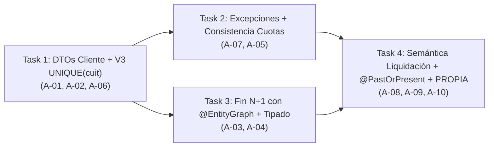

# Plan de Implementación — Bloque 1: Saneamiento Pre-Fase 2.B (Deudas A-01 a A-10)

## Metadata
- **Proyecto:** SGCH 2.0
- **Bloque:** Bloque 1 — Saneamiento de Deuda Técnica Post-Auditoría Fase 2.A (`A-01` a `A-10`)
- **Fecha:** 2026-11-04
- **Autor:** Francisco De Zan (con Antigravity Argon High)
- **Modelo de ejecución:** Argon High para planificación; Flash High para ejecución de Tasks 1 a 4
- **Total tasks:** 4 (Task 1 a Task 4)
- **Duración estimada:** 1.5 a 2 semanas (a ritmo de 10 h/semana; 4 sesiones ejecutables con checkpoints)
- **Estado:** DONE (2026-11-04). Bloque 1 completado y verificado. 157/157 tests backend verdes. Último commit: 486c7ee.

---

## Objetivo del Bloque 1
Resolver las 10 deudas técnicas y de diseño (`A-01` a `A-10`) detectadas en la auditoría final de Fase 2.A para que la Fase 2.B (Frontend de Operaciones) arranque sobre una base limpia, sin deuda estructural y con contratos REST 100% estables.

---

## Criterios de éxito
- 4 tasks completadas secuencialmente bajo disciplina de TDD estricto (`R-026`), revisión doble (`spec-reviewer` + `code-reviewer`, `R-036`), checkpoints humanos obligatorios (`R-037`) y commits atómicos (`R-038`).
- `142 + N` tests de backend en verde (`N` estimado en `12-16` tests nuevos, alcanzando `154-158` tests totales sin fallos ni skips).
- `75/75` tests de frontend (Vitest) siguen pasando en verde sin modificar ningún archivo de `frontend/`.
- `0` warnings de compilación en Maven (`mvnw clean test-compile`) y `0` tipos `List` raw en servicios, controladores, repositorios y tests (`A-04`, `RNF05`).
- Deudas `A-01` a `A-10`: `0` abiertas (8 resueltas en código + migración `V3`, y 2 decisiones de diseño pragmáticas —`A-05` Opción c y `A-08` Opción a— blindadas con validaciones/tests en servicio y documentadas explícitamente como `NA-015` y `NA-016` en `RULINGS.md`).
- Contrato JSON de `/api/clientes` y `/api/v1/clientes` verificado 100% isomórfico al de la entidad `Cliente` mediante test específico de serialización/integración en `ClienteControllerTest`.
- Push a `origin/main` al cierre del bloque verificado (`R-089`).

---

## Dependencias entre tasks
- `Task 1` → (independiente; se ejecuta primero por su impacto estructural sobre el contrato de Clientes y la migración Flyway `V3`)
- `Task 2` → depende de `Task 1` (`GlobalExceptionHandler` mapea la constraint `uk_clientes_cuit` creada en `V3` y `ClienteControllerTest` ya opera sobre `ClienteRequest`/`ClienteResponse`)
- `Task 3` → depende de `Task 1` (`ClienteService`, `OperacionService` y `CobroService` consolidan su tipado parametrizado y JavaDoc sobre el esquema `V3` ya activo)
- `Task 4` → depende de `Task 2` y `Task 3` (extiende las validaciones de `OperacionRequest`, documenta `NA-015`/`NA-016` en `RULINGS.md` y cierra la suite de `CalculadoraFinancieraServiceCapa3Test`)
- **Orden de ejecución obligatorio:** secuencial `Task 1` → `Task 2` → `Task 3` → `Task 4`.



---

## Tabla resumen

| # | Task | Deps | Tests esperados | Cierre |
|---|---|---|---|---|
| **1** | Contrato Clientes con DTOs isomórficos y `V3` `UNIQUE(cuit)` (`A-01`, `A-02`, `A-06`) | ninguna | 142 existentes + 4 nuevos (`146` backend) + `75` frontend verdes | `feat(clientes): introduce isomorphic ClienteRequest/ClienteResponse DTOs and V3 unique cuit constraint` |
| **2** | Excepciones de integridad detalladas y consistencia de `fecha_base_plazo` (`A-07`, `A-05`) | Task 1 | 146 existentes + 4 nuevos (`150` backend) | `fix(api): refine DataIntegrityViolationException messages and validate uniform fechaBasePlazo across cuotas` |
| **3** | Eliminación de N+1 en `OperacionService.findAll` y tipado/JavaDoc (`A-03`, `A-04`) | Task 1 (secuencial tras Task 2) | 150 existentes + 2 nuevos (`152` backend, 1 query para 100 ops `<500ms`) | `perf(operaciones): resolve N+1 in findAll via @EntityGraph and enforce strict generic typing` |
| **4** | Semántica de `estadoLiquidacion`, `@PastOrPresent` en `fechaOperacion` y cobertura 100% de `PROPIA` (`A-08`, `A-09`, `A-10`) | Task 2, Task 3 | 152 existentes + 5 nuevos (`157` backend) + actualización `RULINGS.md` | `feat(operaciones): add @PastOrPresent to fechaOperacion, expand PROPIA Capa 3 tests and document NA-015/NA-016` |

---

## Detalle de cada task

### Task 1 — Contrato Clientes con DTOs isomórficos y migración V3 (`A-01` + `A-02` + `A-06`)
- **Modelo:** Flash High
- **Deps:** ninguna
- **Objetivo:** Cumplir la regla 2 de [AGENTS.md](file:///C:/Users/frans/Desktop/SGCH%202.0/AGENTS.md) en [ClienteController.java](file:///C:/Users/frans/Desktop/SGCH%202.0/backend/src/main/java/com/sgch/controller/ClienteController.java) introduciendo `ClienteRequest`, `ClienteResponse` y `ClienteMapper` con contrato JSON 100% isomórfico a [Cliente.java](file:///C:/Users/frans/Desktop/SGCH%202.0/backend/src/main/java/com/sgch/model/Cliente.java), eliminar el `TODO` activo en [ClienteService.java](file:///C:/Users/frans/Desktop/SGCH%202.0/backend/src/main/java/com/sgch/service/ClienteService.java#L72) (`R-054`), y agregar la restricción `UNIQUE (cuit)` en la tabla `clientes` mediante la migración Flyway `V3`.
- **Archivos a crear:**
  - `backend/src/main/java/com/sgch/dto/ClienteRequest.java`:
    - Clase con `@Getter`, `@Setter`, `@NoArgsConstructor`, `@AllArgsConstructor`.
    - Debe contener exactamente los mismos 15 nombres de propiedades y tipos Java que [Cliente.java](file:///C:/Users/frans/Desktop/SGCH%202.0/backend/src/main/java/com/sgch/model/Cliente.java) para garantizar compatibilidad total con [ClienteForm.tsx](file:///C:/Users/frans/Desktop/SGCH%202.0/frontend/src/components/clientes/ClienteForm.tsx) y [MobileCopilot.tsx](file:///C:/Users/frans/Desktop/SGCH%202.0/frontend/src/components/clientes/MobileCopilot.tsx):
      1. `id` (`String`, opcional; ignorado al persistir pero aceptado sin error cuando el frontend envía el objeto completo en `PUT /api/clientes/{id}`).
      2. `nombreRazonSocial` (`String`, `@NotBlank(message = "Nombre/Razón Social es obligatorio")`, `@Size(max = 255, message = "El nombre o razón social no puede superar 255 caracteres")`).
      3. `cuit` (`String`, `@Pattern(regexp = "^\\d{11}$", message = "El CUIT debe tener 11 dígitos")`).
      4. `condicionFiscal` (`CondicionFiscal`, opcional; default `CondicionFiscal.RESPONSABLE_INSCRIPTO` en mapper y service).
      5. `telefono` (`String`, `@NotBlank(message = "Teléfono es obligatorio")`, `@Size(max = 50, message = "El teléfono no puede superar 50 caracteres")`).
      6. `email` (`String`, `@Email(message = "El formato de email no es válido")`, `@Size(max = 255, message = "El email no puede superar 255 caracteres")`).
      7. `direccion` (`String`, `@NotBlank(message = "Dirección es obligatoria")`, `@Size(max = 255, message = "La dirección no puede superar 255 caracteres")`).
      8. `latitud` (`BigDecimal`).
      9. `longitud` (`BigDecimal`).
      10. `calificacion` (`CalificacionCliente`).
      11. `tipoHacienda` (`String`).
      12. `formasPagoPreferidas` (`String`).
      13. `observaciones` (`String`).
      14. `fechaUltimaOperacion` (`LocalDateTime`).
      15. `fechaUltimoContacto` (`LocalDateTime`).
  - `backend/src/main/java/com/sgch/dto/ClienteResponse.java`:
    - Record Java inmutable con las mismas 15 componentes en idéntico orden y nombres que [Cliente.java](file:///C:/Users/frans/Desktop/SGCH%202.0/backend/src/main/java/com/sgch/model/Cliente.java):
      `id`, `nombreRazonSocial`, `cuit`, `condicionFiscal`, `telefono`, `email`, `direccion`, `latitud`, `longitud`, `calificacion`, `tipoHacienda`, `formasPagoPreferidas`, `observaciones`, `fechaUltimaOperacion`, `fechaUltimoContacto`.
  - `backend/src/main/java/com/sgch/mapper/ClienteMapper.java`:
    - Componente `@Component` puro (sin MapStruct ni reflexión mágica, alineado con [OperacionMapper.java](file:///C:/Users/frans/Desktop/SGCH%202.0/backend/src/main/java/com/sgch/mapper/OperacionMapper.java) y [CobroMapper.java](file:///C:/Users/frans/Desktop/SGCH%202.0/backend/src/main/java/com/sgch/mapper/CobroMapper.java)).
    - `public Cliente toEntity(ClienteRequest request)`: retorna `null` si `request == null`; instancia `Cliente`, no copia `id` (deja `id = null`), aplica default `CondicionFiscal.RESPONSABLE_INSCRIPTO` cuando `request.getCondicionFiscal() == null`, y copia los demás campos.
    - `public ClienteResponse toResponse(Cliente entity)`: retorna `null` si `entity == null`; construye `ClienteResponse` con los 15 campos de `entity` (aplicando `CondicionFiscal.RESPONSABLE_INSCRIPTO` si `entity.getCondicionFiscal()` fuera nulo en mocks de tests).
  - `backend/src/main/resources/db/migration/V3__add_unique_cuit_to_clientes.sql`:
    - `ALTER TABLE clientes ADD CONSTRAINT uk_clientes_cuit UNIQUE (cuit);`
- **Archivos a modificar:**
  - [Cliente.java](file:///C:/Users/frans/Desktop/SGCH%202.0/backend/src/main/java/com/sgch/model/Cliente.java#L35-L37):
    - Actualizar `@Column(name = "cuit", length = 11)` a `@Column(name = "cuit", unique = true, length = 11)`.
  - [ClienteController.java](file:///C:/Users/frans/Desktop/SGCH%202.0/backend/src/main/java/com/sgch/controller/ClienteController.java):
    - Inyectar `ClienteMapper mapper` junto a `ClienteService service`.
    - Cambiar las firmas públicas para no exponer `Cliente`:
      - `getAll(): List<ClienteResponse>`
      - `getById(@PathVariable String id): ClienteResponse`
      - `create(@Valid @RequestBody ClienteRequest request): ClienteResponse`
      - `update(@PathVariable String id, @Valid @RequestBody ClienteRequest request): ClienteResponse`
  - [ClienteService.java](file:///C:/Users/frans/Desktop/SGCH%202.0/backend/src/main/java/com/sgch/service/ClienteService.java#L53-L88):
    - Mantener el fallback de `condicionFiscal` en `save(Cliente)` como segunda barrera defensiva (`I-01`, `NA-012`).
    - En `update(String id, Cliente source)`: eliminar la línea `// TODO(Iteración 2): Resolver copia de campos con DTOs y evitar merge completo.` (`A-02`, `R-054`), y copiar además `target.setFechaUltimaOperacion(source.getFechaUltimaOperacion())` y `target.setFechaUltimoContacto(source.getFechaUltimoContacto())` para preservar la actualización de fechas enviada por `ClienteForm.tsx` y `MobileCopilot.tsx`.
  - [ClienteControllerTest.java](file:///C:/Users/frans/Desktop/SGCH%202.0/backend/src/test/java/com/sgch/controller/ClienteControllerTest.java):
    - Agregar `@Import(ClienteMapper.class)` en la clase de test `@WebMvcTest(ClienteController.class)`.
    - Actualizar los 13 tests existentes para serializar `ClienteRequest` en las peticiones `POST`/`PUT` manteniendo intactas todas las aserciones `jsonPath`.
    - Agregar 2 tests nuevos (ver abajo).
  - [ClienteRepositoryTest.java](file:///C:/Users/frans/Desktop/SGCH%202.0/backend/src/test/java/com/sgch/repository/ClienteRepositoryTest.java):
    - Agregar 2 tests nuevos de integración contra MySQL 8 en Testcontainers para validar la migración `V3`.
- **Tests a escribir:**
  1. `ClienteControllerTest.testJsonContractIsomorphismBetweenEntityAndResponse`: construir un `Cliente` con sus 15 campos poblados (incluyendo `latitud`, `longitud`, `cuit`, `condicionFiscal`, `calificacion`, `fechaUltimaOperacion`, `fechaUltimoContacto`), ejecutar `POST /api/clientes` enviando un payload JSON crudo (sin usar la clase `ClienteRequest` del lado del cliente HTTP) y verificar que el árbol JSON (`JsonNode`) devuelto por el endpoint con `ClienteResponse` es exactamente igual (`assertThat(responseNode).isEqualTo(expectedEntityNode)`) al serializado directamente desde la entidad `Cliente`.
  2. `ClienteControllerTest.testCreateClienteWithInvalidCuitReturnsBadRequest`: enviar `cuit = "12345"` (menos de 11 dígitos) en `POST /api/v1/clientes` y verificar `400 Bad Request` con `$.errores.cuit == "El CUIT debe tener 11 dígitos"`.
  3. `ClienteRepositoryTest.testUniqueCuitThrowsException`: persistir dos clientes con el mismo `cuit` (`"20301112224"`) y distinto `telefono`, y verificar que `saveAndFlush` lanza `DataIntegrityViolationException`.
  4. `ClienteRepositoryTest.testMultipleNullCuitsAllowed`: persistir dos clientes con `cuit = null` y distinto `telefono`, y verificar que MySQL 8 permite múltiples valores `NULL` bajo `uk_clientes_cuit`.
- **Criterios de aceptación:**
  - `ClienteController` no importa ni expone la entidad `Cliente` en ninguna firma de método público (`AGENTS.md` regla 2).
  - `0` ocurrencias de `TODO` en `backend/src/main/java/**` (`R-054`).
  - Flyway aplica `V1`, `V2` y `V3` sin errores en todos los `*RepositoryTest`.
  - Los 75 tests de Vitest en `frontend/` pasan en verde sin tocar ni un archivo de `frontend/`.
  - `146/146` tests de backend en verde.
- **Comandos de verificación:**
  - `.\backend\mvnw.cmd -f backend/pom.xml clean test`
  - `npm --prefix frontend run test -- --run`
  - `Select-String -Path "backend/src/main/java/com/sgch/**/*.java" -Pattern "TODO"` → 0 matches.
- **Commit sugerido:** `feat(clientes): introduce isomorphic ClienteRequest/ClienteResponse DTOs and V3 unique cuit constraint`
- **Riesgos:** En los tests existentes de `ClienteControllerTest` donde el mock `clienteService` retorna una instancia de `Cliente` con `condicionFiscal` por defecto (`RESPONSABLE_INSCRIPTO`), el `ClienteMapper` real importado con `@Import(ClienteMapper.class)` transformará esa entidad en `ClienteResponse` sin alterar ningún campo JSON. Si el JSON de salida difiere en un solo campo respecto de la entidad `Cliente`, PARAR y corregir antes de avanzar.

---

### Task 2 — Excepciones de integridad detalladas y consistencia de cuotas (`A-07` + `A-05`)
- **Modelo:** Flash High
- **Deps:** Task 1
- **Objetivo:** Reemplazar el mensaje estático de `DataIntegrityViolationException` en [GlobalExceptionHandler.java](file:///C:/Users/frans/Desktop/SGCH%202.0/backend/src/main/java/com/sgch/exception/GlobalExceptionHandler.java#L40-L43) por un mapeo semántico según la constraint violada (`A-07`), y garantizar en [OperacionService.java](file:///C:/Users/frans/Desktop/SGCH%202.0/backend/src/main/java/com/sgch/service/OperacionService.java#L216-L239) que todas las cuotas de una misma operación compartan la misma `fechaBasePlazo` (`A-05`, Opción c reforzada).
- **Decisión arquitectónica sobre `A-05` (`fecha_base_plazo`):**
  - Se evalúan las 3 opciones planteadas:
    - *Opción (a) — Mover `fecha_base_plazo` a `operaciones`:* contradice directamente [DOCUMENTO DE REQUERIMIENTOS - SGCH v2.md §6.4](file:///C:/Users/frans/Desktop/SGCH%202.0/docs/superpowers/specs/DOCUMENTO%20DE%20REQUERIMIENTOS%20-%20SGCH%20v2.md#L254) y `R-076`, que definen `fecha_base_plazo` en `CuotaOperacion`. Obligaría a alterar el esquema de `V2` vía `V3`, modificar `Operacion`, `CuotaOperacion`, `OperacionRequest`, `OperacionResponse`, `CuotaOperacionRequest`, `CuotaOperacionResponse`, `OperacionMapper` y reescribir más de 15 tests existentes sin beneficio funcional.
    - *Opción (b) — Trigger en MySQL 8:* contradice la convención de migraciones limpias sin lógica procedural ni triggers en base de datos (`AGENTS.md` regla 3).
    - *Opción (c) — Mantener en `cuotas_operacion`, blindar validación cross-cuota en `OperacionService.validarReglasNegocio` y documentar `NA-015`:* mantiene 100% de conformidad con `v3.2 §6.4` y `R-076`, centraliza la barrera en el único punto por donde pasan tanto `create()` como `update()` (`AGENTS.md`: *"Fix it once, where all callers route through"*), y deja documentada la ausencia de constraint cross-row en SQL como `NA-015`. **Se elige Opción (c).**
- **Archivos a modificar:**
  - [GlobalExceptionHandler.java](file:///C:/Users/frans/Desktop/SGCH%202.0/backend/src/main/java/com/sgch/exception/GlobalExceptionHandler.java#L40-L43):
    - En `handleDataIntegrity(DataIntegrityViolationException ex)`:
      - Extraer el mensaje de la causa más específica (`Throwable cause = ex.getMostSpecificCause(); String msg = (cause != null && cause.getMessage() != null) ? cause.getMessage().toLowerCase() : "";`).
      - Si `msg` contiene `"telefono"` → retornar `ProblemDetail` 409 con `detail = "Ya existe un cliente registrado con ese teléfono"`.
      - Si `msg` contiene `"uk_clientes_cuit"` o `"cuit"` → retornar `ProblemDetail` 409 con `detail = "Ya existe un cliente registrado con ese CUIT"`.
      - Si `msg` contiene `"uk_cuota_operacion_numero"` → retornar `ProblemDetail` 409 con `detail = "Ya existe una cuota con ese número para la operación"`.
      - Si `msg` contiene `"foreign key"` o `"fk_"` → retornar `ProblemDetail` 409 con `detail = "No se puede completar la operación porque el registro tiene datos asociados"`.
      - En cualquier otro caso → retornar `ProblemDetail` 409 con `detail = "Error de integridad de datos (ej. teléfono o CUIT duplicado)"`.
  - [OperacionService.java](file:///C:/Users/frans/Desktop/SGCH%202.0/backend/src/main/java/com/sgch/service/OperacionService.java#L216-L239):
    - En `validarReglasNegocio(OperacionRequest request)`:
      - Si `request.getCuotas() != null && request.getCuotas().size() > 1`: verificar que todas las cuotas tengan el mismo `fechaBasePlazo` efectivo (considerando que `null` toma el default `FechaBasePlazo.CARGA`). Si existen dos cuotas con distinto `FechaBasePlazo` (ej. cuota 1 `CARGA` y cuota 2 `REMATE`), lanzar `IllegalArgumentException("Todas las cuotas de la operacion deben compartir la misma fecha base de plazo (CARGA o REMATE)")`.
  - [ClienteControllerTest.java](file:///C:/Users/frans/Desktop/SGCH%202.0/backend/src/test/java/com/sgch/controller/ClienteControllerTest.java#L80-L90):
    - Actualizar `testUniqueConflictReturnsProblemDetail` al nuevo mensaje o desglosarlo en casos específicos por constraint.
  - [OperacionServiceTest.java](file:///C:/Users/frans/Desktop/SGCH%202.0/backend/src/test/java/com/sgch/service/OperacionServiceTest.java):
    - Agregar tests unitarios de rechazo en `create` y `update` cuando las cuotas tienen `fechaBasePlazo` inconsistente.
- **Tests a escribir:**
  1. `ClienteControllerTest.testDuplicateTelefonoReturnsSpecificConflictDetail`: simular `DataIntegrityViolationException("Duplicate entry '3415551234' for key 'clientes.telefono'")` y verificar `409 Conflict` con `$.detail == "Ya existe un cliente registrado con ese teléfono"`.
  2. `ClienteControllerTest.testDuplicateCuitReturnsSpecificConflictDetail`: simular `DataIntegrityViolationException("Duplicate entry '20301112224' for key 'clientes.uk_clientes_cuit'")` y verificar `409 Conflict` con `$.detail == "Ya existe un cliente registrado con ese CUIT"`.
  3. `ClienteControllerTest.testForeignKeyViolationOnDeleteReturnsSpecificConflictDetail`: simular `DataIntegrityViolationException("Cannot delete or update a parent row: a foreign key constraint fails (fk_operaciones_comprador)")` en `DELETE /api/v1/clientes/1` y verificar `409 Conflict` con `$.detail == "No se puede completar la operación porque el registro tiene datos asociados"`.
  4. `OperacionServiceTest.testCreateYUpdateConCuotasFechaBasePlazoInconsistente_lanzaIllegalArgumentException`: enviar cuota 1 con `FechaBasePlazo.CARGA` y cuota 2 con `FechaBasePlazo.REMATE` en `create` y en `update`, verificando que ambos lanzan `IllegalArgumentException` con mensaje que contiene `"fecha base de plazo"`.
- **Criterios de aceptación:**
  - `GlobalExceptionHandler` distingue violaciones de unicidad de `telefono`, `cuit`, número de cuota y claves foráneas devolviendo mensajes claros en español bajo RFC 7807/9457 (`R-008`).
  - `OperacionService` impide tanto en alta como en edición persistir cuotas con `fechaBasePlazo` mezcladas dentro de una misma operación.
  - `150/150` tests de backend en verde.
- **Comandos de verificación:**
  - `.\backend\mvnw.cmd -f backend/pom.xml test -Dtest=ClienteControllerTest,OperacionControllerTest,OperacionServiceTest`
- **Commit sugerido:** `fix(api): refine DataIntegrityViolationException messages and validate uniform fechaBasePlazo across cuotas`
- **Riesgos:** Si una cuota explícita viene con `fechaBasePlazo == null` y otra con `FechaBasePlazo.CARGA`, ambas equivalen a `CARGA` (porque `guardarCuotasExplicitas` asigna `CARGA` por defecto cuando es `null`). La validación debe resolver primero el valor efectivo (`req.getFechaBasePlazo() != null ? req.getFechaBasePlazo() : FechaBasePlazo.CARGA`) antes de comparar, para no rechazar falsamente una combinación de `null` y `CARGA`.

---

### Task 3 — Eliminación de N+1 en `OperacionService.findAll` y tipado estricto (`A-03` + `A-04`)
- **Modelo:** Flash High
- **Deps:** Task 1 (ejecutada secuencialmente después de Task 2)
- **Objetivo:** Eliminar el problema de N+1 queries en [OperacionService.findAll](file:///C:/Users/frans/Desktop/SGCH%202.0/backend/src/main/java/com/sgch/service/OperacionService.java#L82-L120) mediante `@EntityGraph` sobre `comprador`, `vendedor` y `cuotas` en [OperacionRepository.java](file:///C:/Users/frans/Desktop/SGCH%202.0/backend/src/main/java/com/sgch/repository/OperacionRepository.java) (`A-03`, `RNF02`), eliminar los warnings de `List` raw en tests (`A-04`) y completar el JavaDoc de los métodos públicos de servicios para cumplir el criterio del 80% de `RNF05`.
- **Archivos a modificar:**
  - [Operacion.java](file:///C:/Users/frans/Desktop/SGCH%202.0/backend/src/main/java/com/sgch/model/Operacion.java):
    - Agregar la relación inversa `@OneToMany(mappedBy = "operacion", fetch = FetchType.LAZY) @OrderBy("numeroCuota ASC") private List<CuotaOperacion> cuotas = new ArrayList<>();`.
    - Nota: al usar `mappedBy = "operacion"`, no altera el esquema SQL ni la validación `ddl-auto: validate` de Hibernate 7, y al usar `@EqualsAndHashCode(onlyExplicitlyIncluded = true)` sobre `id` (`R-023`), no impacta `equals`/`hashCode`.
  - [OperacionRepository.java](file:///C:/Users/frans/Desktop/SGCH%202.0/backend/src/main/java/com/sgch/repository/OperacionRepository.java):
    - Sobrescribir el método de `JpaSpecificationExecutor<Operacion>` con `@EntityGraph`:
      ```java
      @Override
      @EntityGraph(attributePaths = {"comprador", "vendedor", "cuotas"})
      List<Operacion> findAll(Specification<Operacion> spec);
      ```
  - [OperacionService.java](file:///C:/Users/frans/Desktop/SGCH%202.0/backend/src/main/java/com/sgch/service/OperacionService.java#L113-L119):
    - En `findAll(...)`: reemplazar la consulta N+1 `cuotaOperacionRepository.findByOperacionIdOrderByNumeroCuotaAsc(op.getId())` por la lectura directa de la colección ya inicializada por el `@EntityGraph`:
      `List<CuotaOperacion> cuotas = op.getCuotas() != null ? op.getCuotas() : List.of();`
    - Agregar JavaDoc en todos los métodos públicos (`create`, `findAll`, `findById`, `update`) conforme a `RNF05`.
  - [CobroService.java](file:///C:/Users/frans/Desktop/SGCH%202.0/backend/src/main/java/com/sgch/service/CobroService.java) y [CalculadoraFinancieraService.java](file:///C:/Users/frans/Desktop/SGCH%202.0/backend/src/main/java/com/sgch/service/CalculadoraFinancieraService.java):
    - Confirmar parametrización estricta `List<CobroResponse>` y agregar JavaDoc en los métodos públicos (`RNF05`).
  - [OperacionServiceTest.java](file:///C:/Users/frans/Desktop/SGCH%202.0/backend/src/test/java/com/sgch/service/OperacionServiceTest.java):
    - Declarar `@Captor private ArgumentCaptor<List<CuotaOperacion>> cuotasCaptor;` a nivel de clase, eliminando las 3 ocurrencias de `ArgumentCaptor.forClass(List.class)` y `@SuppressWarnings("unchecked")` en las líneas 229, 249, 274, 296, 378 y 398, así como el import no usado de `Specification`.
    - Agregar test unitario de `findAll` verificando que no invoca `cuotaOperacionRepository.findByOperacionIdOrderByNumeroCuotaAsc`.
  - [OperacionRepositoryTest.java](file:///C:/Users/frans/Desktop/SGCH%202.0/backend/src/test/java/com/sgch/repository/OperacionRepositoryTest.java):
    - Agregar test de performance y conteo de queries SQL para 100 operaciones con sus cuotas.
- **Tests a escribir:**
  1. `OperacionRepositoryTest.testFindAllWithSpecificationExecutesSingleQueryFor100OperacionesUnder500ms`:
     - Persistir 1 comprador, 1 vendedor y 100 `Operacion`, cada una con 2 `CuotaOperacion` asociadas (200 cuotas en total).
     - Ejecutar `entityManager.flush()` y `entityManager.clear()` (`R-085`).
     - Obtener `SessionFactory` desde `entityManager.getEntityManagerFactory().unwrap(SessionFactory.class)`, habilitar `Statistics` (`stats.setStatisticsEnabled(true); stats.clear();`).
     - Medir con `System.nanoTime()` la ejecución de `operacionRepository.findAll((Specification<Operacion>) (root, query, cb) -> cb.conjunction())` y recorrer las 100 operaciones leyendo `op.getComprador().getNombreRazonSocial()`, `op.getVendedor().getNombreRazonSocial()` y `op.getCuotas().size()`.
     - Verificar:
       - `assertThat(operaciones).hasSize(100)`
       - Cada operación tiene `2` cuotas ordenadas (`numeroCuota` 1 y 2).
       - `assertThat(stats.getPrepareStatementCount()).isEqualTo(1L)` (exactamente 1 sentencia SQL emitida para traer las 100 operaciones + comprador + vendedor + 200 cuotas).
       - `assertThat(elapsedMs).isLessThan(500L)` (`RNF02`).
  2. `OperacionServiceTest.test13_findAllUsaCuotasDelEntityGraphSinConsultarRepositorioPorCadaOperacion`:
     - Configurar `operacionRepository.findAll(any(Specification.class))` para retornar 2 operaciones con sus listas `cuotas` cargadas.
     - Invocar `operacionService.findAll(null, null, null, null, null)`.
     - Verificar que retorna 2 `OperacionResponse` con sus cuotas mapeadas y que `verify(cuotaOperacionRepository, never()).findByOperacionIdOrderByNumeroCuotaAsc(any())` se cumple.
- **Criterios de aceptación:**
  - `OperacionService.findAll` ejecuta `1` sola query SQL independientemente de la cantidad de operaciones retornadas.
  - `0` warnings de compilación (`-Xlint:rawtypes`, `-Xlint:unchecked`).
  - `100%` de los métodos públicos de `ClienteService`, `OperacionService`, `CobroService` y `CalculadoraFinancieraService` cuentan con JavaDoc (`RNF05` exige `>= 80%`).
  - `152/152` tests de backend en verde.
- **Comandos de verificación:**
  - `.\backend\mvnw.cmd -f backend/pom.xml clean test-compile`
  - `.\backend\mvnw.cmd -f backend/pom.xml test -Dtest=OperacionRepositoryTest,OperacionServiceTest`
- **Commit sugerido:** `perf(operaciones): resolve N+1 in findAll via @EntityGraph and enforce strict generic typing`
- **Riesgos:** Cuando Hibernate 7 ejecuta un `LEFT JOIN FETCH` (vía `@EntityGraph`) sobre una colección `@OneToMany` (`cuotas`) para 100 padres con 2 hijos cada uno, el `ResultSet` JDBC tiene 200 filas que Hibernate deduplica en memoria en 100 instancias de `Operacion` (comportamiento estándar por defecto en Hibernate 6/7 sin necesidad de `DISTINCT`). El test `testFindAllWithSpecificationExecutesSingleQueryFor100OperacionesUnder500ms` debe verificar explícitamente `assertThat(operaciones).hasSize(100)` para confirmar que no hay duplicación de referencias.
- **Nota de expansión aprobada (2026-11-04):** se aprueba agregar `@OneToMany(mappedBy = "operacion", fetch = FetchType.LAZY) @OrderBy("numeroCuota ASC")` en `Operacion.java` y `@EntityGraph(attributePaths = {"comprador", "vendedor", "cuotas"})` en `OperacionRepository.findAll(Specification<Operacion>)`. Es técnicamente necesaria para resolver el N+1 en 1 sola query (detectado en auditoría final de Fase 2.A: `OperacionMapper.toResponse` accede a `comprador.getNombreRazonSocial()` y `vendedor.getNombreRazonSocial()` sobre relaciones LAZY). `mappedBy` no altera el esquema SQL. Se documenta como NA-017 (candidato) en Task 4.

---

### Task 4 — Semántica de `estadoLiquidacion`, `@PastOrPresent` en `fechaOperacion` y cobertura 100% de `PROPIA` (`A-08` + `A-09` + `A-10`)
- **Modelo:** Flash High
- **Deps:** Task 2, Task 3
- **Objetivo:** Formalizar y testear la semántica de `estadoLiquidacion` entre `create` y `update` (`A-08`, Opción a reforzada), impedir la carga de operaciones con `fechaOperacion` futura mediante `@PastOrPresent` en [OperacionRequest.java](file:///C:/Users/frans/Desktop/SGCH%202.0/backend/src/main/java/com/sgch/dto/OperacionRequest.java#L27-L28) (`A-09`), ampliar [CalculadoraFinancieraServiceCapa3Test.java](file:///C:/Users/frans/Desktop/SGCH%202.0/backend/src/test/java/com/sgch/service/CalculadoraFinancieraServiceCapa3Test.java#L145-L175) para cubrir al 100% las variantes del circuito `PROPIA` (`A-10`), y registrar `NA-015` y `NA-016` en [RULINGS.md](file:///C:/Users/frans/Desktop/SGCH%202.0/.superpowers/sdd/migracion-boot4/RULINGS.md).
- **Decisión arquitectónica sobre `A-08` (`estadoLiquidacion` en `OperacionRequest`):**
  - Se evalúan las 3 opciones planteadas:
    - *Opción (b) — Separar `OperacionCreateRequest` y `OperacionUpdateRequest`:* duplicaría una clase de 35 atributos validados con Jakarta Bean Validation por una sola propiedad (`estadoLiquidacion`), violando frontalmente [AGENTS.md](file:///C:/Users/frans/Desktop/SGCH%202.0/AGENTS.md) (*"No unrequested abstractions. Fewest files possible. Shortest working diff wins"*).
    - *Opción (c) — Forzar `PENDIENTE` también en `update`:* introduciría un bug regresivo grave: si una operación ya tiene cobros imputados en `CobroService` (`estadoLiquidacion = PARCIALMENTE_PAGADO` o `LIQUIDADO` según `RN05` y `R-083`) y el operador edita un dato descriptivo en `PUT /api/v1/operaciones/{id}` (como `observaciones` o `fleteMonto`), forzar `PENDIENTE` borraría el estado de liquidación real calculado a partir de los cobros.
    - *Opción (a) reforzada — Mantener un único `OperacionRequest`, preservar el estado actual en `update` cuando `request.getEstadoLiquidacion() == null`, permitir override explícito en `update` cuando no es nulo, y documentar en JavaDoc + `NA-016`:* respeta `NA-009`, `RN05`, `R-083` y `AGENTS.md`. El frontend de Fase 2.B simplemente omite `estadoLiquidacion` en `POST` y en `PUT` ordinarios (enviando `null`), con lo cual `create` nace en `PENDIENTE` y `update` preserva intacto el estado derivado de `CobroService`. **Se elige Opción (a) reforzada.**
- **Archivos a modificar:**
  - [OperacionRequest.java](file:///C:/Users/frans/Desktop/SGCH%202.0/backend/src/main/java/com/sgch/dto/OperacionRequest.java#L27-L28):
    - Agregar `@PastOrPresent(message = "La fecha de operacion no puede ser futura")` (importando `jakarta.validation.constraints.PastOrPresent`) sobre `private LocalDateTime fechaOperacion;`.
    - Agregar comentario JavaDoc sobre `estadoLiquidacion` documentando que en `POST` se ignora (forzando `PENDIENTE` per `RN05`/`NA-009`) y en `PUT` es opcional (si es `null`, conserva el estado actual de la operación).
  - [OperacionDtoValidationTest.java](file:///C:/Users/frans/Desktop/SGCH%202.0/backend/src/test/java/com/sgch/dto/OperacionDtoValidationTest.java):
    - Agregar test unitario de validación Jakarta verificando que `fechaOperacion = LocalDateTime.now().plusDays(1)` dispara violación en `fechaOperacion` con el mensaje `"La fecha de operacion no puede ser futura"`, y que `LocalDateTime.now().minusMinutes(1)` es válido.
    - **Nota de robustez (2026-11-04):** todas las fechas de fixtures en OperacionDtoValidationTest, OperacionControllerTest y OperacionServiceTest que hoy usan fechas literales (`LocalDateTime.of(2026, 11, 3, ...)`) deben migrarse a `LocalDateTime.now().minusDays(1)` para que `@PastOrPresent` no falle en runners CI con reloj anterior a noviembre 2026. Aplica también a los tests nuevos de Task 4.
  - [OperacionServiceTest.java](file:///C:/Users/frans/Desktop/SGCH%202.0/backend/src/test/java/com/sgch/service/OperacionServiceTest.java):
    - Agregar test unitario verificando la semántica de `estadoLiquidacion` en `update`: cuando `opExistente` está en `PARCIALMENTE_PAGADO` y `request.getEstadoLiquidacion()` es `null`, `update` preserva `PARCIALMENTE_PAGADO`; cuando `request.getEstadoLiquidacion()` es `LIQUIDADO`, `update` aplica `LIQUIDADO`.
  - [CalculadoraFinancieraServiceCapa3Test.java](file:///C:/Users/frans/Desktop/SGCH%202.0/backend/src/test/java/com/sgch/service/CalculadoraFinancieraServiceCapa3Test.java#L145-L175):
    - Expandir la cobertura del circuito `PROPIA` con 3 nuevos métodos de test dedicados:
      1. `test08b_propia_ventaPropiaConSpreadYModalidadFinalEsIdenticaADirectoConComisionVendedorCero`: firma vende hacienda propia (`comisionPorcentajeVendedor = 0.00`, `comisionPorcentajeComprador = 3.00`), `modalidadPrecio = FINAL`, `montoExtraCobradoComprador = 500000.00`. Verifica los 4 saldos de Capa 3 al centavo y su igualdad exacta con `DIRECTO` bajo los mismos parámetros (`totalACobrarComprador == saldoComisionFirma`).
      2. `test08c_propia_compraPropiaConVendedorMonotributistaExentoYOverridesEsIdenticaADirecto`: firma compra para sí (`comisionPorcentajeComprador = 0.00`, `comisionPorcentajeVendedor = 2.50`), probando vendedor `MONOTRIBUTISTA`/`EXENTO` (`ivaGanado = 0.00`, `R-075`) y luego con `ivaGanadoMontoOverride` e `ivaComisionVendedorOverride` activos (`R-079`). Verifica que `totalACobrarComprador = 0.00`, `totalAPagarVendedor = 0.00` y que los 4 saldos coinciden al centavo con `DIRECTO`.
      3. `test08d_propia_ambasComisionesCeroProduceSaldoComisionCeroYSaldoHaciendaIntacto`: `comisionPorcentajeVendedor = 0.00` y `comisionPorcentajeComprador = 0.00` en `PROPIA`, verificando `saldoComisionFirma = 0.00`, `totalACobrarComprador = 0.00`, `totalAPagarVendedor = 0.00` y `saldoHaciendaEntrePartes = subtotalGanado + ivaGanado`.
  - [RULINGS.md](file:///C:/Users/frans/Desktop/SGCH%202.0/.superpowers/sdd/migracion-boot4/RULINGS.md):
    - Agregar `NA-015` (resolución de `A-05` mediante validación cross-cuota en `OperacionService` preservando `fecha_base_plazo` en `cuotas_operacion` per `v3.2 §6.4` y `R-076`) y `NA-016` (resolución de `A-08` preservando un único `OperacionRequest` donde `create` fuerza `PENDIENTE` y `update` conserva el estado actual si el campo es `null` per `NA-009` y `AGENTS.md`).
    - Agregar fila correspondiente en la tabla `Historial de Cambios`.
- **Tests a escribir:**
  1. `OperacionDtoValidationTest.fechaOperacionFuturaDisparaViolacionPastOrPresent`: `req.setFechaOperacion(LocalDateTime.now().plusDays(1))` → 1 violación en propiedad `"fechaOperacion"` con mensaje `"La fecha de operacion no puede ser futura"`.
  2. `OperacionServiceTest.test14_updateOperacionPreservaEstadoLiquidacionCuandoRequestTraeNullYActualizaCuandoNoEsNull`: verifica ambas ramas de `update` sobre `estadoLiquidacion`.
  3. `CalculadoraFinancieraServiceCapa3Test.test08b_propia_ventaPropiaConSpreadYModalidadFinalEsIdenticaADirectoConComisionVendedorCero`.
  4. `CalculadoraFinancieraServiceCapa3Test.test08c_propia_compraPropiaConVendedorMonotributistaExentoYOverridesEsIdenticaADirecto`.
  5. `CalculadoraFinancieraServiceCapa3Test.test08d_propia_ambasComisionesCeroProduceSaldoComisionCeroYSaldoHaciendaIntacto`.
- **Criterios de aceptación:**
  - `POST /api/v1/operaciones` y `PUT /api/v1/operaciones/{id}` rechazan cualquier `fechaOperacion` en el futuro con `400 Bad Request` (`ProblemDetail` con `errores.fechaOperacion`).
  - `CalculadoraFinancieraServiceCapa3Test` cubre al 100% compra propia, venta propia, ambas comisiones en cero, modalidad `FINAL`, spread y overrides en circuito `PROPIA`.
  - `NA-015` y `NA-016` documentados en `RULINGS.md`.
  - `157/157` tests de backend y `75/75` tests de frontend en verde.
- **Comandos de verificación:**
  - `.\backend\mvnw.cmd -f backend/pom.xml clean test`
  - `npm --prefix frontend run test -- --run`
- **Commit sugerido:** `feat(operaciones): add @PastOrPresent to fechaOperacion, expand PROPIA Capa 3 tests and document NA-015/NA-016`
- **Riesgos:** Las fechas fijas en tests existentes (`LocalDateTime.of(2026, 11, 3, 10, 0)`) son pasadas respecto del reloj del entorno (`2026-11-04`), por lo que pasan `@PastOrPresent`. No obstante, si en el futuro se ejecuta el build en un runner CI con reloj UTC anterior a noviembre de 2026, una fecha literal `2026-11-03` fallaría `@PastOrPresent`. Para blindar los tests ante cualquier reloj de sistema, actualizar en `OperacionDtoValidationTest`, `OperacionControllerTest` y `OperacionServiceTest` la fecha base del fixture a `LocalDateTime.now().minusDays(1)` (o una fecha histórica como `2026-01-15T10:00`).

---

## Checkpoints y verificación global

### Protocolo obligatorio al cierre de cada task (`R-026`, `R-036`, `R-037`, `R-038`)
1. **TDD estricto (`R-026`):** escribir primero los tests nuevos de la task y ejecutarlos para confirmar el fallo esperado (estado RED); implementar el código mínimo necesario hasta pasar a verde (estado GREEN); refactorizar manteniendo toda la suite en verde.
2. **Revisión por pares (`R-036`):** invocar `spec-reviewer` (verificando conformidad contra este plan, `v3.2`, `Anexo II v1.1` y `RULINGS.md`) y `code-reviewer` (verificando ausencia de sobreingeniería per `AGENTS.md`, precisión `BigDecimal` y `0` warnings). Si hay hallazgos, corregir y re-verificar antes de commitear.
3. **Commit atómico (`R-038`):** realizar un único commit por task con el mensaje Conventional Commits estipulado. No hacer `git push` entre tasks individuales.
4. **Checkpoint humano (`R-037`):** reportar `git log -1 --stat`, conteo total de tests de backend y frontend, salida de compilación y veredicto de ambos reviewers. **Detenerse y esperar aprobación explícita del usuario antes de iniciar la siguiente task.**

### Verificación global al cierre del Bloque 1 (post-Task 4)
1. **Suite completa de Backend:**
   `.\backend\mvnw.cmd -f backend/pom.xml clean test` → `157/157` tests verdes (`0` failures, `0` errors, `0` skipped, `0` warnings de compilación).
2. **Suite completa de Frontend (contrato JSON intacto):**
   `npm --prefix frontend run test -- --run` → `75/75` tests verdes en las 7 suites de Vitest.
3. **Verificación de árbol y ausencia de TODOs / vocabulario prohibido (`R-054`, `R-066`):**
   - `git diff main -- frontend/` → vacío (`0` archivos modificados en `frontend/`).
   - `Select-String -Path "backend/src/main/java/**" -Pattern "TODO"` → `0` matches.
   - `Select-String -Path "backend/src/**" -Pattern "negro|blanco|informal|porcentaje_facturado"` → `0` matches (excepto `Raza.NEGRO` legítimo del dominio bovino).
4. **Push a `origin/main` (`R-089`):**
   Una vez verificada la suite completa y aprobado el cierre de Task 4, ejecutar `git push origin main` (sin `--force`, sin rebase) y verificar coincidencia de hashes `git rev-parse HEAD origin/main`.

---

## Riesgos y ajustes sugeridos

### 1. Cuantificación de impacto de `A-05` (`fecha_base_plazo`)
- Si se hubiera elegido la **Opción (a)** (mover `fecha_base_plazo` de `cuotas_operacion` a `operaciones`), el cambio habría impactado **9 archivos** (`V3__*.sql`, `Operacion.java`, `CuotaOperacion.java`, `OperacionRequest.java`, `OperacionResponse.java`, `CuotaOperacionRequest.java`, `CuotaOperacionResponse.java`, `OperacionMapper.java`, `OperacionService.java`) y habría roto **16 tests existentes** distribuidos en `CuotaOperacionRepositoryTest`, `OperacionMapperTest`, `OperacionServiceTest` y `OperacionControllerTest`, además de entrar en contradicción directa con el diccionario de datos de `v3.2 §6.4` y el ruling `R-076`.
- Con la **Opción (c) reforzada** adoptada en Task 2 (mantener la columna en `cuotas_operacion`, validar en `OperacionService.validarReglasNegocio` que todas las cuotas de una operación tengan igual `fechaBasePlazo` efectivo y documentar `NA-015`), el cambio toca **1 solo método privado** en `OperacionService.java`, rompe **0 tests existentes** y garantiza la invariante tanto en `POST` como en `PUT`. Si en post-MVP el usuario decidiera migrar la columna a `operaciones`, podrá hacerse en una migración dedicada junto con el rediseño de cronogramas.

### 2. Cuantificación de impacto de `A-08` (`estadoLiquidacion` en `OperacionRequest`)
- Si se hubiera elegido la **Opción (b)** (separar `OperacionCreateRequest` y `OperacionUpdateRequest`), habría sido necesario duplicar un DTO de **150 líneas y 35 atributos validados** (o introducir una jerarquía de herencia en DTOs) y modificar las firmas de `OperacionController` (`POST` vs `PUT`), `OperacionService.create` vs `update`, `OperacionMapper` y 3 clases de test (`OperacionDtoValidationTest`, `OperacionMapperTest`, `OperacionControllerTest`).
- Si se hubiera elegido la **Opción (c)** (forzar siempre `PENDIENTE` también en `update`), editar cualquier campo descriptivo de una operación ya cobrada parcialmente o liquidada habría sobrescrito su estado a `PENDIENTE`, desincronizando la operación respecto de sus registros en `cobros`.
- Con la **Opción (a) reforzada** adoptada en Task 4, se mantiene un único `OperacionRequest`, `create` fuerza siempre `PENDIENTE` (`RN05`, `NA-009`), `update` conserva el estado existente si el request envía `null`, y se documenta el contrato en JavaDoc y `NA-016` para que el frontend de Fase 2.B nunca envíe `estadoLiquidacion` en formularios de carga/edición de operaciones.

### 3. Riesgo crítico de regresión en el contrato JSON de `/api/clientes` (Fase B)
- El frontend actual ([ClienteForm.tsx](file:///C:/Users/frans/Desktop/SGCH%202.0/frontend/src/components/clientes/ClienteForm.tsx) y [MobileCopilot.tsx](file:///C:/Users/frans/Desktop/SGCH%202.0/frontend/src/components/clientes/MobileCopilot.tsx)) envía en `PUT /api/clientes/{id}` un spread completo del objeto `Cliente` recibido en el `GET` previo (incluyendo `id`, `fechaUltimaOperacion`, `fechaUltimoContacto`, `cuit` y `condicionFiscal`).
- Por ello, `ClienteRequest` y `ClienteResponse` en Task 1 **deben declarar exactamente los mismos 15 campos con idénticos nombres y tipos** que `Cliente.java`, y `ClienteService.update` debe copiar `fechaUltimaOperacion` y `fechaUltimoContacto` además de los campos básicos. Si el contrato JSON de `/api/clientes` cambiara aunque sea en el nombre o formato de un campo, **PARAR inmediatamente y reportar**, ya que no se puede romper el frontend de Fase B.

### 4. Subdivisión de tasks
- Las 4 tasks definidas tienen un tamaño acotado (2 a 5 archivos por task, 2 a 5 tests nuevos por task), por lo que **ninguna necesita subdividirse** y pueden ejecutarse limpiamente en 4 sesiones con `Flash High`.

---

## Fuentes
1. [2026-11-03-iteracion-2-fase-2a-backend.md](file:///C:/Users/frans/Desktop/SGCH%202.0/docs/superpowers/plans/2026-11-03-iteracion-2-fase-2a-backend.md) — Plan aprobado y completado (`DONE`) de Fase 2.A (patrón de referencia de tasks con TDD, two-reviewer y checkpoints).
2. [RULINGS.md](file:///C:/Users/frans/Desktop/SGCH%202.0/.superpowers/sdd/migracion-boot4/RULINGS.md) — Registro canónico de decisiones técnicas `R-001` a `R-089` y notas de auditoría `NA-001` a `NA-014`.
3. [DOCUMENTO DE REQUERIMIENTOS - SGCH v2.md](file:///C:/Users/frans/Desktop/SGCH%202.0/docs/superpowers/specs/DOCUMENTO%20DE%20REQUERIMIENTOS%20-%20SGCH%20v2.md) — Especificación funcional y modelo de datos canónico v3.2 (`§4 RNF01–RNF07`, `§5 RN01–RN10`, `§6.1 Cliente`, `§6.2 Operación`, `§6.4 CuotaOperacion`, `§6.5 Cobro`).
4. [ANEXO-II-Modelo-Calculo-Fiscal.md](file:///C:/Users/frans/Desktop/SGCH%202.0/docs/superpowers/specs/ANEXO-II-Modelo-Calculo-Fiscal.md) — Especificación matemática v1.1 del motor de cálculo en 3 capas (`§2 Capa 1`, `§3 Capa 2`, `§4 Capa 3` incluyendo circuito `PROPIA`, y `§6` ejemplos de regresión).
5. [DECISIONES-NEGOCIO.md](file:///C:/Users/frans/Desktop/SGCH%202.0/docs/superpowers/research/DECISIONES-NEGOCIO.md) — Decisiones de negocio determinadas `D-01` a `D-14` y decisiones de arquitectura `DA-01` a `DA-05` (`DA-04` sobre cuentas propias en circuito `PROPIA`).
6. [AGENTS.md](file:///C:/Users/frans/Desktop/SGCH%202.0/AGENTS.md) — Reglas globales del proyecto (ProblemDetail RFC 7807, DTOs obligatorios desde Iteración 2, filosofía *Lazy Senior Dev* / YAGNI).
7. Hallazgos `A-01` a `A-10` de la Auditoría Final de Fase 2.A (provistos en la especificación de esta tarea).
