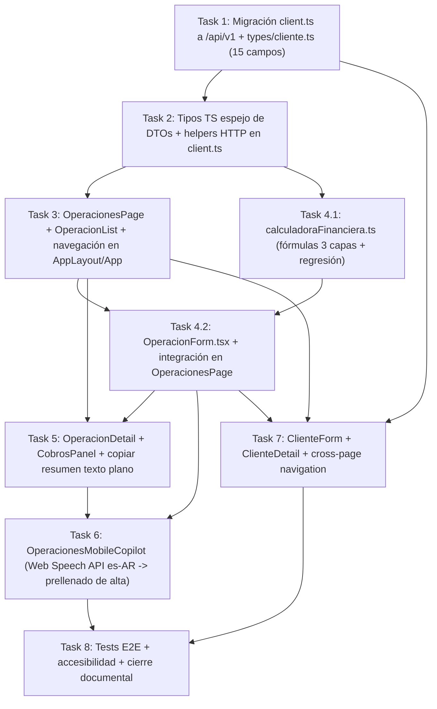

# Plan de Implementación — Fase 2.B (Frontend Operaciones, Cálculo Fiscal en Vivo, Cuotas y Cobranzas)

## Metadata
- **Proyecto:** SGCH 2.0
- **Bloque:** Fase 2.B — Frontend Operaciones (cierre de Iteración 2)
- **Fecha:** 2026-11-05
- **Autor:** Francisco De Zan (con Antigravity Pro High)
- **Modelo de ejecución:** Pro High para planificación y revisión arquitectónica; Flash High para ejecución de Tasks 1-8
- **Total tasks:** 9 (Task 1, Task 2, Task 3, Task 4.1, Task 4.2, Task 5, Task 6, Task 7, Task 8)
- **Duración estimada:** 3-4 semanas a 10 h/semana (9 sesiones de trabajo con checkpoints). Subdivisión Task 4 y nueva Task 7 aprobadas 2026-11-05.
- **Estado:** APROBADO (2026-11-05). 9 tasks (Tasks 1, 2, 3, 4.1, 4.2, 5, 6, 7, 8). Total estimado ~133 tests frontend (75 + 58 nuevos).

---

## Objetivo de Fase 2.B
Completar la interfaz de usuario de la Iteración 2 migrando el cliente HTTP a `/api/v1` e implementando el módulo completo de Operaciones (`OperacionesPage`, `OperacionList`, `OperacionForm` con previsualización del cálculo fiscal en 3 capas y opción de copiar operación previa, `OperacionDetail` con cronograma de cuotas y copiado de resumen en texto plano, `CobrosPanel` para imputación de cobranzas, `OperacionesMobileCopilot` para dictado de voz en móvil, y navegación cross-page e historial de operaciones en Clientes) bajo TDD estricto en Vitest.

---

## Criterios de éxito
- 9 tasks completadas en orden con ciclo TDD estricto (`RED -> GREEN -> refactor`, `R-026`), revisión doble (`spec-reviewer` + `code-reviewer`, `R-036`), checkpoints humanos (`R-037`) y commits atómicos (`R-038`).
- `75 + N` tests Vitest en verde (`N` estimado en 57 tests nuevos, total ~132 tests frontend).
- 2 tests de `ClienteDetail.test.tsx` actualizados justificadamente (botón pasa de disabled a enabled + placeholder sustituido por sección de historial). Los otros 73 tests de Fase B permanecen intactos.
- Cross-page navigation desde `ClienteDetail` a `OperacionesPage` con cliente pre-seleccionado (`compradorId` o `vendedorId`).
- `157/157` tests backend en verde sin modificar ningún archivo dentro de `backend/`.
- Flujo E2E funcional verificado en Vitest: navegar a Operaciones o desde Clientes con cliente preseleccionado -> crear operación con preview de cálculo -> inspeccionar detalle y cuotas -> registrar cobros (hacienda y comisión) -> verificar transición a estado `LIQUIDADO`.
- Accesibilidad básica verificada en todos los componentes nuevos: navegación por teclado, `aria-label` explícitos, `role="status"` / `role="alert"` y estados de foco visibles (`focus:ring`).
- Contrato JSON de [`frontend/src/api/client.ts`](file:///C:/Users/frans/Desktop/SGCH%202.0/frontend/src/api/client.ts) migrado a `/api/v1` (`R-061`) y [`frontend/src/types/cliente.ts`](file:///C:/Users/frans/Desktop/SGCH%202.0/frontend/src/types/cliente.ts) ampliado a los 15 campos isomórficos de [`ClienteResponse.java`](file:///C:/Users/frans/Desktop/SGCH%202.0/backend/src/main/java/com/sgch/dto/ClienteResponse.java).
- `0` errores y `0` warnings al ejecutar `npx --prefix frontend tsc -b --noEmit`.
- `0` emojis en componentes nuevos, textos de botones, banners y mensajes de `Toast` (todos los íconos mediante `<svg>` inline con `stroke="currentColor"` y `aria-hidden="true"`, `R-042`).

---

## Dependencias



- `Task 1` -> sin dependencias previas (parte de `HEAD dddfeed`).
- `Task 2` -> depende de `Task 1` (reutiliza `CondicionFiscal` de `types/cliente.ts` y `apiFetch` migrado a `/api/v1`).
- `Task 3` -> depende de `Task 2` (consume `OperacionResponse`, `ModalidadCircuito`, `EstadoLiquidacion` y `getOperaciones`).
- `Task 4.1` -> depende de `Task 2` (consume `ModalidadCircuito`, `ModalidadPrecio`, `CondicionFiscal` y `CalculoResultado`).
- `Task 4.2` -> depende de `Task 4.1` y `Task 3` (se integra en las vistas `'alta'` y `'edicion'` de `OperacionesPage`).
- `Task 5` -> depende de `Task 3` y `Task 4.2` (se integra en la vista `'detalle'` de `OperacionesPage`).
- `Task 6` -> depende de `Task 4.2` y `Task 5` (conecta el dictado móvil en vista `'lista'` con el prellenado de `OperacionForm` en vista `'alta'`).
- `Task 7` -> depende de `Task 1`, `Task 3` y `Task 4.2` (agrega `cuit`/`condicionFiscal` a `ClienteForm`, y reutiliza el mecanismo de `initialDraft` que `Task 4.2` crea en `OperacionesPage` para la navegación cross-page desde `ClienteDetail`).
- `Task 8` -> depende de `Task 6` y `Task 7` (verifica el flujo completo integrado y cierra la documentación de Fase 2.B e Iteración 2).

---

## Tabla resumen

| # | Task | Deps | Tests esperados | Commit |
|---|---|---|---|---|
| **1** | Migración `client.ts` a `/api/v1` + ampliar `types/cliente.ts` | ninguna | 75 existentes verdes (8 aserciones de prefijo en `client.test.ts` actualizadas a `/api/v1`) | `feat(api): migrate apiFetch default prefix to /api/v1 and add fiscal fields to Cliente type` |
| **2** | Tipos TS espejo de DTOs de Operaciones/Cobros + helpers en `client.ts` | Task 1 | +5 tests en `client.test.ts` (`getOperaciones`, `getOperacionById`, `createOperacion`, `updateOperacion`, `cobros`) | `feat(types): add TypeScript interfaces for operaciones, cuotas, cobros and calculo` |
| **3** | `OperacionesPage` + `OperacionList` (Master-Detail + filtros + `AppLayout`) | Task 2 | +10 tests (`OperacionList.test.tsx`: 5, `OperacionesPage.test.tsx`: 5) | `feat(operaciones): add OperacionList, OperacionesPage with filters and module navigation` |
| **4.1** | `calculadoraFinanciera.ts` + tests de regresión (Capas 1, 2 y 3) | Task 2 | +7 tests en `calculadoraFinanciera.test.ts` (incluye Ejemplo 1, 2, FINAL, Monotributo, Overrides, Consignataria y PROPIA) | `feat(operaciones): add pure TS calculator mirroring Capa 1+2+3` |
| **4.2** | `OperacionForm.tsx` + integración en `OperacionesPage` | Tasks 4.1, 3 | +8 tests en `OperacionForm.test.tsx` (validación, preview, copy, desbaste, alta, edición, guard, errores) | `feat(operaciones): add OperacionForm with live preview and copy` |
| **5** | `OperacionDetail` + `CobrosPanel` + botón copiar resumen en texto plano | Tasks 3, 4.2 | +10 tests (`OperacionDetail.test.tsx`: 5, `CobrosPanel.test.tsx`: 5) | `feat(operaciones): add OperacionDetail, CobrosPanel and plain-text summary copy` |
| **6** | `OperacionesMobileCopilot` (Web Speech API `es-AR` -> prellenado de alta) | Tasks 4.2, 5 | +6 tests (`OperacionesMobileCopilot.test.tsx`: 6) | `feat(operaciones): add OperacionesMobileCopilot with voice dictation prefill` |
| **7** | `ClienteForm` + `ClienteDetail` + cross-page navigation | Tasks 1, 3, 4.2 | +7 tests nuevos (+2 en `ClienteForm`, +3 en `ClienteDetail`, +1 en `ClientesPage`, +1 en `App`; 2 tests de `ClienteDetail` actualizados) | `feat(clientes): enable operaciones nav from ClienteDetail and add cuit + condicionFiscal to ClienteForm` |
| **8** | Tests E2E en Vitest + accesibilidad + cierre documental | Tasks 6, 7 | +5 tests E2E en `OperacionesFlow.test.tsx` (~132 tests frontend totales) | `test(operaciones): add E2E lifecycle tests, accessibility checks and close Fase 2.B docs` |

---

## Detalle de cada task

### Task 1 — Migración `client.ts` a `/api/v1` + ampliar `types/cliente.ts`
- **Modelo:** Flash High
- **Deps:** ninguna
- **Objetivo:** Ejecutar la migración Opción C (`R-061`) cambiando el prefijo por defecto de `apiFetch` en [`frontend/src/api/client.ts`](file:///C:/Users/frans/Desktop/SGCH%202.0/frontend/src/api/client.ts#L22-L24) de `/api` a `/api/v1`, ampliar [`frontend/src/types/cliente.ts`](file:///C:/Users/frans/Desktop/SGCH%202.0/frontend/src/types/cliente.ts#L1-L17) con `CondicionFiscal` y los campos `cuit` y `condicionFiscal` para igualar los 15 campos de [`ClienteResponse.java`](file:///C:/Users/frans/Desktop/SGCH%202.0/backend/src/main/java/com/sgch/dto/ClienteResponse.java#L9-L25), y actualizar las aserciones de ruta en [`frontend/src/api/client.test.ts`](file:///C:/Users/frans/Desktop/SGCH%202.0/frontend/src/api/client.test.ts).
- **Archivos a modificar:**
  - [`frontend/src/api/client.ts`](file:///C:/Users/frans/Desktop/SGCH%202.0/frontend/src/api/client.ts#L22-L24):
    - En `apiFetch`, cambiar la línea de normalización:
      - Antes: `` : `/api${endpoint.startsWith('/') ? '' : '/'}${endpoint}`; ``
      - Después: `` : `/api/v1${endpoint.startsWith('/') ? '' : '/'}${endpoint}`; ``
    - Mantener `endpoint.startsWith('/api') ? endpoint` intacto para que rutas explícitas como `/api/health` no se dupliquen.
  - [`frontend/src/types/cliente.ts`](file:///C:/Users/frans/Desktop/SGCH%202.0/frontend/src/types/cliente.ts#L1-L17):
    - Exportar el tipo unión `CondicionFiscal = 'RESPONSABLE_INSCRIPTO' | 'MONOTRIBUTISTA' | 'EXENTO' | 'CONSUMIDOR_FINAL'` (espejo exacto de [`CondicionFiscal.java`](file:///C:/Users/frans/Desktop/SGCH%202.0/backend/src/main/java/com/sgch/model/CondicionFiscal.java#L3-L8)).
    - Agregar en `interface Cliente`: `cuit?: string | null;` y `condicionFiscal?: CondicionFiscal;`.
  - [`frontend/src/api/client.test.ts`](file:///C:/Users/frans/Desktop/SGCH%202.0/frontend/src/api/client.test.ts):
    - Actualizar las 8 aserciones de URL que verifican el prefijo inyectado por `apiFetch`:
      1. `L26-44` (`prepends /api/v1 to endpoint if missing`): `'/api/clientes'` -> `'/api/v1/clientes'`.
      2. `L61-74` (`handles endpoint without leading slash`): `'/api/clientes'` -> `'/api/v1/clientes'`.
      3. `L76-98` (`merges custom headers with default headers`): `'/api/custom'` -> `'/api/v1/custom'`.
      4. `L193-204` (`getClientes`): `'/api/clientes'` -> `'/api/v1/clientes'`.
      5. `L206-217` (`getClienteById`): `'/api/clientes/123'` -> `'/api/v1/clientes/123'`.
      6. `L219-242` (`createCliente`): `'/api/clientes'` -> `'/api/v1/clientes'`.
      7. `L244-261` (`updateCliente`): `'/api/clientes/123'` -> `'/api/v1/clientes/123'`.
      8. `L263-278` (`deleteCliente`): `'/api/clientes/123'` -> `'/api/v1/clientes/123'`.
    - Mantener intacto el test `L46-59` (`does not duplicate /api prefix if already present` con `'/api/health'`).
- **Tests a escribir / actualizar:**
  - En `client.test.ts`: actualizar primero las 8 aserciones a `/api/v1/...` (estado RED: fallan porque `client.ts` aún prepende `/api`), aplicar el cambio de 1 línea en `client.ts` (estado GREEN: los 14 tests de `client.test.ts` y los 75 totales pasan).
- **Criterios de aceptación:**
  - `apiFetch('/clientes')` invoca `fetch('/api/v1/clientes', ...)`.
  - `types/cliente.ts` expone los 15 campos de `ClienteResponse.java` con `cuit?: string | null` y `condicionFiscal?: CondicionFiscal`.
  - `75/75` tests Vitest en verde; `npx --prefix frontend tsc -b --noEmit` sin errores.
- **Comandos de verificación:**
  - `npm --prefix frontend run test -- --run`
  - `npx --prefix frontend tsc -b --noEmit`
- **Commit sugerido:** `feat(api): migrate apiFetch default prefix to /api/v1 and add fiscal fields to Cliente type`
- **Riesgos:** El prompt original mencionaba 4 tests en `client.test.ts` (proveniente de la nota `M-07` de Fase 2.A que contó solo el bloque `describe('apiFetch')`), pero `describe('helper methods')` en `client.test.ts:184-279` contiene 5 tests adicionales que también verifican la URL final pasada a `mockFetch`. Actualizar los 8 evita falsos fallos.

---

### Task 2 — Tipos TS espejo de DTOs de Operaciones/Cobros + helpers HTTP en `client.ts`
- **Modelo:** Flash High
- **Deps:** Task 1
- **Objetivo:** Crear los contratos TypeScript que espejan campo por campo y enum por enum los DTOs de Operaciones, Cuotas, Cálculo Fiscal y Cobros del backend, y agregar los helpers tipados en `frontend/src/api/client.ts` siguiendo la regla 1 y regla 2 de [`.agents/rules/frontend-react.md`](file:///C:/Users/frans/Desktop/SGCH%202.0/.agents/rules/frontend-react.md#L9-L17).
- **Archivos a crear:**
  - `frontend/src/types/calculoResultado.ts`:
    - Espejo exacto de [`CalculoResultado.java`](file:///C:/Users/frans/Desktop/SGCH%202.0/backend/src/main/java/com/sgch/dto/CalculoResultado.java#L5-L17) (11 campos `number`): `subtotalGanado`, `comisionVendedorMonto`, `comisionCompradorMonto`, `ivaGanado`, `ivaComisionVendedorMonto`, `ivaComisionCompradorMonto`, `montoExtraCobradoComprador`, `saldoHaciendaEntrePartes`, `saldoComisionFirma`, `totalACobrarComprador`, `totalAPagarVendedor`.
  - `frontend/src/types/cuotaOperacion.ts`:
    - Enums string espejo de Java:
      - `FechaBasePlazo = 'CARGA' | 'REMATE'` ([`FechaBasePlazo.java`](file:///C:/Users/frans/Desktop/SGCH%202.0/backend/src/main/java/com/sgch/model/FechaBasePlazo.java))
      - `EstadoCuotaCobro = 'PENDIENTE' | 'PARCIAL' | 'COBRADO'` ([`EstadoCuotaCobro.java`](file:///C:/Users/frans/Desktop/SGCH%202.0/backend/src/main/java/com/sgch/model/EstadoCuotaCobro.java))
      - `EstadoCuotaPago = 'PENDIENTE' | 'PARCIAL' | 'PAGADO'` ([`EstadoCuotaPago.java`](file:///C:/Users/frans/Desktop/SGCH%202.0/backend/src/main/java/com/sgch/model/EstadoCuotaPago.java))
    - `interface CuotaOperacionResponse` (10 campos espejo de [`CuotaOperacionResponse.java`](file:///C:/Users/frans/Desktop/SGCH%202.0/backend/src/main/java/com/sgch/dto/CuotaOperacionResponse.java#L10-L21)): `id: string`, `numeroCuota: number`, `fechaBasePlazo: FechaBasePlazo`, `diasPlazoComprador: number`, `diasDescalceVendedor: number`, `fechaVencimientoComprador: string`, `fechaVencimientoVendedor: string`, `montoCuota: number`, `estadoCobro: EstadoCuotaCobro`, `estadoPago: EstadoCuotaPago`.
    - `interface CuotaOperacionRequest` (7 campos espejo de [`CuotaOperacionRequest.java`](file:///C:/Users/frans/Desktop/SGCH%202.0/backend/src/main/java/com/sgch/dto/CuotaOperacionRequest.java#L19-L38)): `numeroCuota?: number`, `fechaBasePlazo?: FechaBasePlazo`, `diasPlazoComprador: number`, `diasDescalceVendedor?: number`, `fechaVencimientoComprador?: string`, `fechaVencimientoVendedor?: string`, `montoCuota: number`.
  - `frontend/src/types/operacion.ts`:
    - Re-exportar `CondicionFiscal` desde `./cliente`, `CalculoResultado` desde `./calculoResultado`, y tipos de cuota desde `./cuotaOperacion`.
    - Enums string espejo exacto de Java:
      - `ModalidadCircuito = 'DIRECTO' | 'CONSIGNATARIA_EXTERNA' | 'PROPIA'` ([`ModalidadCircuito.java`](file:///C:/Users/frans/Desktop/SGCH%202.0/backend/src/main/java/com/sgch/model/ModalidadCircuito.java))
      - `CategoriaOperacion = 'FAENA' | 'INVERNADA' | 'REPRODUCCION'` ([`CategoriaOperacion.java`](file:///C:/Users/frans/Desktop/SGCH%202.0/backend/src/main/java/com/sgch/model/CategoriaOperacion.java))
      - `ModalidadPrecio = 'NETO' | 'FINAL'` ([`ModalidadPrecio.java`](file:///C:/Users/frans/Desktop/SGCH%202.0/backend/src/main/java/com/sgch/model/ModalidadPrecio.java))
      - `CondicionEntrega = 'A_RETIRAR_CAMPO' | 'PUESTO_EN_PLANTA'` ([`CondicionEntrega.java`](file:///C:/Users/frans/Desktop/SGCH%202.0/backend/src/main/java/com/sgch/model/CondicionEntrega.java))
      - `FleteCargoDe = 'COMPRADOR' | 'VENDEDOR' | 'NINGUNO'` ([`FleteCargoDe.java`](file:///C:/Users/frans/Desktop/SGCH%202.0/backend/src/main/java/com/sgch/model/FleteCargoDe.java))
      - `EstadoLiquidacion = 'PENDIENTE' | 'PARCIALMENTE_PAGADO' | 'LIQUIDADO'` ([`EstadoLiquidacion.java`](file:///C:/Users/frans/Desktop/SGCH%202.0/backend/src/main/java/com/sgch/model/EstadoLiquidacion.java))
      - `Raza = 'BRANGUS' | 'COLORADO' | 'NEGRO' | 'BRAFORD' | 'DEFINIDO' | 'VARIOS'` ([`Raza.java`](file:///C:/Users/frans/Desktop/SGCH%202.0/backend/src/main/java/com/sgch/model/Raza.java))
    - `interface OperacionResponse` (47 campos exactos de [`OperacionResponse.java`](file:///C:/Users/frans/Desktop/SGCH%202.0/backend/src/main/java/com/sgch/dto/OperacionResponse.java#L9-L57)).
    - `interface OperacionRequest` (espejo de [`OperacionRequest.java`](file:///C:/Users/frans/Desktop/SGCH%202.0/backend/src/main/java/com/sgch/dto/OperacionRequest.java#L26-L165), omitiendo `estadoLiquidacion` en envíos ordinarios conforme a `NA-009` / `NA-016` / `A-08`).
    - `interface OperacionFiltros`: `circuito?: ModalidadCircuito`, `clienteId?: string`, `estado?: EstadoLiquidacion`, `fechaDesde?: string`, `fechaHasta?: string`.
  - `frontend/src/types/cobro.ts`:
    - Enums string espejo de Java:
      - `TipoMovimientoCobro = 'COBRO_COMPRADOR' | 'PAGO_VENDEDOR' | 'COBRO_COMISION' | 'RETENCION_SALDO' | 'DEVOLUCION_SALDO'` ([`TipoMovimientoCobro.java`](file:///C:/Users/frans/Desktop/SGCH%202.0/backend/src/main/java/com/sgch/model/TipoMovimientoCobro.java))
      - `MedioPago = 'ECHEQ' | 'TRANSFERENCIA' | 'CHEQUE_FISICO' | 'EFECTIVO' | 'CANJE_ESPECIE'` ([`MedioPago.java`](file:///C:/Users/frans/Desktop/SGCH%202.0/backend/src/main/java/com/sgch/model/MedioPago.java))
    - `interface CobroResponse` (12 campos espejo de [`CobroResponse.java`](file:///C:/Users/frans/Desktop/SGCH%202.0/backend/src/main/java/com/sgch/dto/CobroResponse.java#L9-L22)).
    - `interface CobroRequest` (8 campos espejo de [`CobroRequest.java`](file:///C:/Users/frans/Desktop/SGCH%202.0/backend/src/main/java/com/sgch/dto/CobroRequest.java#L20-L47)).
- **Archivos a modificar:**
  - [`frontend/src/api/client.ts`](file:///C:/Users/frans/Desktop/SGCH%202.0/frontend/src/api/client.ts): agregar helpers tipados:
    - `getOperaciones(filtros?: OperacionFiltros): Promise<OperacionResponse[]>` (construye query string con `URLSearchParams` solo para parámetros no vacíos).
    - `getOperacionById(id: string): Promise<OperacionResponse>`
    - `createOperacion(operacion: OperacionRequest): Promise<OperacionResponse>`
    - `updateOperacion(id: string, operacion: OperacionRequest): Promise<OperacionResponse>`
    - `getCobrosByOperacion(operacionId: string): Promise<CobroResponse[]>`
    - `createCobro(cobro: CobroRequest): Promise<CobroResponse>`
  - [`frontend/src/api/client.test.ts`](file:///C:/Users/frans/Desktop/SGCH%202.0/frontend/src/api/client.test.ts): agregar 5 tests unitarios para los nuevos helpers.
- **Tests a escribir:**
  1. `getOperaciones calls GET /api/v1/operaciones with query params when filters are provided`.
  2. `getOperacionById calls GET /api/v1/operaciones/:id`.
  3. `createOperacion calls POST /api/v1/operaciones with JSON body`.
  4. `updateOperacion calls PUT /api/v1/operaciones/:id with JSON body`.
  5. `getCobrosByOperacion and createCobro call /api/v1/cobros endpoints`.
- **Criterios de aceptación:**
  - Todos los tipos TS coinciden 1:1 con los records Java (`0` diferencias de nombres o nulabilidad).
  - `npx --prefix frontend tsc -b --noEmit` pasa con `0` errores.
  - `80/80` tests Vitest en verde (`75 + 5`).
- **Comandos de verificación:**
  - `npm --prefix frontend run test -- --run src/api/client.test.ts`
  - `npx --prefix frontend tsc -b --noEmit`
- **Commit sugerido:** `feat(types): add TypeScript interfaces for operaciones, cuotas, cobros and calculo`
- **Riesgos:** `OperacionController.getAll` espera `fechaDesde` y `fechaHasta` en formato `ISO.DATE_TIME` (`YYYY-MM-DDTHH:mm:ss`). Cuando el usuario filtra desde un `<input type="date">` (`YYYY-MM-DD`), `getOperaciones` debe normalizar `fechaDesde` agregando `T00:00:00` (si no incluye `T`) y `fechaHasta` agregando `T23:59:59` (si no incluye `T`) para no provocar `400 Bad Request` en Spring MVC.

---

### Task 3 — `OperacionesPage` + `OperacionList` (Master-Detail + filtros + `AppLayout`)
- **Modelo:** Flash High
- **Deps:** Task 2
- **Objetivo:** Implementar el listado de operaciones tipo planilla de cálculo (`RNF01`) con sus 4 estados (`loading`, `error` con reintento, `empty`, `data`), barra de filtros por circuito, estado de liquidación, cliente y rango de fechas, contenedor `OperacionesPage` con navegación por estado (`'lista' | 'detalle' | 'alta' | 'edicion'`, `R-021`) y selector de módulo (`"Clientes"` | `"Operaciones"`) en `AppLayout` y `App`.
- **Archivos a crear:**
  - `frontend/src/components/operaciones/OperacionList.tsx`
  - `frontend/src/components/operaciones/OperacionList.test.tsx`
  - `frontend/src/pages/OperacionesPage.tsx`
  - `frontend/src/pages/OperacionesPage.test.tsx`
- **Archivos a modificar:**
  - [`frontend/src/components/layout/AppLayout.tsx`](file:///C:/Users/frans/Desktop/SGCH%202.0/frontend/src/components/layout/AppLayout.tsx):
    - Aceptar props opcionales `moduloActivo?: 'clientes' | 'operaciones'` y `onSelectModulo?: (modulo: 'clientes' | 'operaciones') => void`.
    - Si `onSelectModulo` está definido, renderizar en el `<header>` (o barra de navegación accesible `<nav aria-label="Navegación principal">`) los botones `"Clientes"` y `"Operaciones"` con `aria-current={moduloActivo === ... ? 'page' : undefined}` e íconos `<svg>` inline (`R-042`). Si no se pasan props, mantener compatibilidad 100% hacia atrás con `AppLayout.test.tsx`.
  - [`frontend/src/App.tsx`](file:///C:/Users/frans/Desktop/SGCH%202.0/frontend/src/App.tsx):
    - Gestionar `const [modulo, setModulo] = useState<'clientes' | 'operaciones'>('clientes')` y renderizar `<ClientesPage />` cuando `modulo === 'clientes'` o `<OperacionesPage />` cuando `modulo === 'operaciones'`. (Al iniciar en `'clientes'`, `App.test.tsx` sigue pasando sin cambios).
- **Diseño de `OperacionList` y `OperacionesPage`:**
  - **Barra de filtros en `OperacionList`:**
    - Select `Circuito` (`Todos`, `DIRECTO`, `CONSIGNATARIA_EXTERNA`, `PROPIA`) con `aria-label="Filtrar por circuito"`.
    - Select `Estado` (`Todos`, `PENDIENTE`, `PARCIALMENTE_PAGADO`, `LIQUIDADO`) con `aria-label="Filtrar por estado"`.
    - Select `Cliente` (`Todos` + opciones de `clientes` recibidos por prop) con `aria-label="Filtrar por cliente"`.
    - Inputs `type="date"` para `Fecha desde` y `Fecha hasta` + botón `"Limpiar filtros"`.
  - **Tabla/Grilla estilo planilla (`RNF01`):**
    - Columnas visibles: Fecha, Circuito (badge semántico), Comprador -> Vendedor, Categoría / Razas, Kg Netos, Precio/kg (`NETO` / `FINAL`), Comisión Firma (`calculo.saldoComisionFirma`), Estado de Liquidación (badge: `PENDIENTE` ámbar, `PARCIALMENTE_PAGADO` azul, `LIQUIDADO` verde) y acción `"Ver detalle"`.
  - **4 estados obligatorios:**
    1. `loading`: spinner `<svg>` inline + `"Cargando operaciones..."`.
    2. `error`: banner rojo con `"No se pudo conectar. Revisá tu conexión a internet."` + botón `"Reintentar"` conectado a `onRefetch`.
    3. `empty`: `"No hay operaciones registradas. Tocá 'Nueva Operación' para cargar la primera."`.
    4. `data`: tabla/tarjetas interactivas con click para abrir detalle.
  - **`OperacionesPage`:**
    - Carga inicial en paralelo (`Promise.all`) de `getOperaciones(filtros)` y `getClientes()` (elevando el estado de `clientes` y `operaciones` al contenedor padre conforme a `R-041`).
    - Subcomponente defensivo `EmptyOperacionFallback` (`role="status"`, `R-046`) cuando `vista === 'detalle'` o `'edicion'` pero `selectedOperacion === null`.
    - `Toast` (`R-047`) conectado para mensajes de éxito (sin emojis, `R-042`).
- **Tests a escribir (10 tests):**
  - En `OperacionList.test.tsx` (5 tests):
    1. Renderiza estado `loading` con texto `"Cargando operaciones..."`.
    2. Renderiza estado `error` y ejecuta `onRefetch` al hacer clic en `"Reintentar"`.
    3. Renderiza estado vacío y dispara `onNuevaOperacion` al tocar `"Nueva Operación"`.
    4. Renderiza filas con comprador, vendedor, kg netos, saldo comisión firma y badge de `estadoLiquidacion`, invocando `onSelectOperacion` al hacer clic.
    5. Dispara `onFilterChange` cuando el operador cambia circuito, estado, cliente o fechas.
  - En `OperacionesPage.test.tsx` (5 tests):
    1. Invoca `getOperaciones` y `getClientes` al montar en vista `'lista'`.
    2. Renderiza `EmptyOperacionFallback` defensivo si `initialVista="detalle"` con `initialSelectedOperacion={null}` y vuelve a `'lista'` al tocar `"Volver"`.
    3. Re-consulta `getOperaciones` con los parámetros de filtro cuando el usuario filtra por circuito o estado.
    4. Navega de `'lista'` a `'detalle'` al seleccionar una operación de la tabla.
    5. En `App`, permite alternar entre el módulo `"Clientes"` y `"Operaciones"` desde la barra superior de `AppLayout`.
- **Criterios de aceptación:**
  - `90/90` tests Vitest en verde (`80 + 10`).
  - `App.test.tsx` y `AppLayout.test.tsx` siguen pasando sin modificaciones destructivas.
  - `0` errores de TypeScript (`tsc -b --noEmit`).
- **Comandos de verificación:**
  - `npm --prefix frontend run test -- --run`
  - `npx --prefix frontend tsc -b --noEmit`
- **Commit sugerido:** `feat(operaciones): add OperacionList, OperacionesPage with filters and module navigation`
- **Riesgos:** Mientras `OperacionForm`, `OperacionDetail` y `OperacionesMobileCopilot` se implementan en Tasks 4.2, 5 y 6, `OperacionesPage` en Task 3 puede conectar vistas mínimas o contenedores delegados que Task 4.2, Task 5 y Task 6 reemplazan en el mismo archivo sin dejar código muerto (`R-028`, `R-054`).

---

### Task 4.1 — `calculadoraFinanciera.ts` + tests de regresión
- **Modelo:** Flash High
- **Deps:** Task 2
- **Objetivo:** Implementar el motor de cálculo financiero y fiscal puro en TypeScript (`frontend/src/utils/calculadoraFinanciera.ts`), espejando las 3 capas del Anexo II v1.1 (§2 Capa 1, §3 Capa 2, §4 Capa 3) y de `CalculadoraFinancieraService.java` con función pura y aritmética monetaria determinista a 2 decimales (`round2`).
- **Archivos a crear:**
  - `frontend/src/utils/calculadoraFinanciera.ts`
  - `frontend/src/utils/calculadoraFinanciera.test.ts`
- **Archivos a modificar:** ninguno
- **Especificación de `calculadoraFinanciera.ts`:**
  - Función pura `calcularPreviewOperacion(input: CalculoPreviewInput): CalculoResultado` con redondeo monetario `round2(n) = Math.round((n + Number.EPSILON) * 100) / 100`:
    - **Capa 1 (§2):** `subtotalGanado = round2(kgNeto * precioKgFacturado)`; `comisionVendedorMonto = round2(subtotalGanado * (comisionPorcentajeVendedor / 100))`; `comisionCompradorMonto = round2(subtotalGanado * (comisionPorcentajeComprador / 100))`.
    - **Capa 2 (§3):**
      - Si `ivaGanadoMontoOverride != null`: usa override. Si `condicionFiscalVendedor !== 'RESPONSABLE_INSCRIPTO'`: `ivaGanado = 0`. Si `modalidadPrecio === 'FINAL'`: `subtotalNeto = round2(subtotalGanado / 1.105)` y `ivaGanado = round2((subtotalGanado - subtotalNeto) * (porcentajeDocumentadoGanado / 100))`. Si `NETO`: `ivaGanado = round2(subtotalGanado * 0.105 * (porcentajeDocumentadoGanado / 100))`.
      - `ivaComisionVendedorMonto`: override o `round2(comisionVendedorMonto * 0.21 * (porcentajeDocumentadoComisionVendedor / 100))`.
      - `ivaComisionCompradorMonto`: override o `round2(comisionCompradorMonto * 0.21 * (porcentajeDocumentadoComisionComprador / 100))`.
    - **Capa 3 (§4):**
      - `CONSIGNATARIA_EXTERNA`: `saldoHaciendaEntrePartes = 0`, `saldoComisionFirma = round2(comisionVendedorMonto + ivaComisionVendedorMonto)`, `totalACobrarComprador = 0`, `totalAPagarVendedor = 0`.
      - `DIRECTO`: `saldoHaciendaEntrePartes = round2(subtotalGanado + ivaGanado)`, `saldoComisionFirma = round2(comisionVendedorMonto + ivaComisionVendedorMonto + comisionCompradorMonto + ivaComisionCompradorMonto + montoExtra)`, `totalACobrarComprador = round2(comisionCompradorMonto + ivaComisionCompradorMonto + montoExtra)`, `totalAPagarVendedor = 0`.
      - `PROPIA`: Mismas fórmulas de saldos que `DIRECTO` pero con comisión pactada en 0 en la punta donde la firma es parte (paridad con `test08b`/`test08c`/`test08d` del backend).
- **Tests a escribir (7 tests en `calculadoraFinanciera.test.ts`):**
  1. Regresión exacta Ejemplo 1 Anexo II §6.1 (`DIRECTO` sin spread, `30.000 kg x $5.000`, `NETO`, `RI`, comisiones `2%`: `subtotalGanado = 150000000`, `ivaGanado = 15750000`, `saldoHaciendaEntrePartes = 165750000`, `saldoComisionFirma = 7260000`, `totalACobrarComprador = 3630000`).
  2. Regresión exacta Ejemplo 2 Anexo II §6.2 (`DIRECTO` con `montoExtraCobradoComprador = 6000000`: `saldoComisionFirma = 13260000`, `totalACobrarComprador = 9630000`).
  3. `ModalidadPrecio = FINAL` con vendedor `RI` desglosa `/ 1.105` y calcula comisión sobre bruto (`R-072`).
  4. Vendedor `MONOTRIBUTISTA`, `EXENTO` o `CONSUMIDOR_FINAL` produce `ivaGanado = 0` (`R-075`).
  5. Overrides manuales de IVA pisan el cálculo automático (`R-079`).
  6. Circuito `CONSIGNATARIA_EXTERNA` retorna `saldoHaciendaEntrePartes = 0` y `saldoComisionFirma = comisionVendedor + ivaComisionVendedor` (`R-071`).
  7. Circuito `PROPIA` produce los mismos 4 saldos que `DIRECTO` con comisión 0 en la punta propia (paridad con `test08b`/`test08c`/`test08d` del backend).
- **Criterios de aceptación:**
  - 7 tests unitarios de regresión financiera pasando en verde al 100%.
  - Cero discrepancias contra el backend en los 7 casos.
  - `npx --prefix frontend tsc -b --noEmit` sin errores.
- **Comandos de verificación:**
  - `npm --prefix frontend run test -- --run src/utils/calculadoraFinanciera.test.ts`
  - `npx --prefix frontend tsc -b --noEmit`
- **Commit sugerido:** `feat(operaciones): add pure TS calculator mirroring Capa 1+2+3`
- **Riesgos:** Ninguno. Lógica pura sin efectos colaterales ni dependencias DOM.

---

### Task 4.2 — `OperacionForm.tsx` + integración en `OperacionesPage`
- **Modelo:** Flash High
- **Deps:** Task 4.1, Task 3
- **Objetivo:** Implementar el formulario completo `OperacionForm.tsx` con soporte para alta, edición, botón `"Copiar de operación anterior"` (`RF07`), autocompletado de `kgNeto` por desbaste (`R-078`), visibilidad condicional por circuito (`CONSIGNATARIA_EXTERNA` / `PROPIA`), panel lateral sticky en vivo con el desglose de las 3 capas conectando `calculadoraFinanciera.ts`, generación/edición de cuotas (`RN08`, `R-073`), guard contra doble-submit (`R-032`), omisión de `estadoLiquidacion` (`A-08`, `NA-009`) e integración en las vistas `'alta'` y `'edicion'` de `OperacionesPage.tsx`.
- **Archivos a crear:**
  - `frontend/src/components/operaciones/OperacionForm.tsx`
  - `frontend/src/components/operaciones/OperacionForm.test.tsx`
- **Archivos a modificar:**
  - `frontend/src/pages/OperacionesPage.tsx` (conectar `<OperacionForm />` en las vistas `'alta'` y `'edicion'`).
- **Especificación de `OperacionForm.tsx`:**
  - **Copiar operación (`RF07`):** Select superior `"Copiar de operación anterior"` con las operaciones existentes; al elegir una y tocar `"Copiar datos"`, puebla todos los campos comerciales/fiscales/tropa manteniendo la fecha de operación en el día actual.
  - **Precarga fiscal por vendedor (`D-14`, `R-075`):** Al seleccionar `vendedorId`, toma `vendedor.condicionFiscal ?? 'RESPONSABLE_INSCRIPTO'` para alimentar el cálculo en vivo de IVA ganado (mostrando un badge informativo con la condición fiscal del vendedor).
  - **Autocompletado de kg netos por desbaste (`R-078`):** Si el usuario ingresa `kgOrigenBruto` y `porcentajeDesbaste` (entre `-8.00` y `+15.00`), calcula sugerencia automática `kgNeto = round2(kgOrigenBruto * (1 - porcentajeDesbaste / 100))` editable manualmente.
  - **Campos condicionales por circuito:**
    - En `CONSIGNATARIA_EXTERNA`: muestra y exige `consignatariaExterna` (obligatorio), habilita `comisionTotalCobradaReferencia` y `retencionesExternasMonto` (`R-080`).
    - En `DIRECTO` y `PROPIA`: oculta y limpia `retencionesExternasMonto` (`null`). En `PROPIA`, valida en cliente que al menos una comisión (`comisionPorcentajeVendedor` o `comisionPorcentajeComprador`) sea `0`.
  - **Sección colapsable de Configuración Fiscal Avanzada (Regla de oro Anexo II §1):** Por defecto `porcentajeDocumentado* = 100` y overrides vacíos, para no trabar la carga rápida; desplegable cuando la operación tiene porcentajes mixtos o overrides manuales (`R-066`, `R-079`).
  - **Panel lateral sticky `"Vista Previa de Liquidación"`:** Muestra en vivo Capa 1 (`subtotalGanado`, comisiones), Capa 2 (`ivaGanado`, IVA comisiones) y Capa 3 (`saldoHaciendaEntrePartes`, `saldoComisionFirma`, `totalACobrarComprador`, `totalAPagarVendedor`).
  - **Guard doble-submit (`R-032`) y errores RFC 7807 (`R-035`):** `if (isSubmitting) return;`, botones deshabilitados con texto `"Guardando..."`, mapeo de `err.data.errores` a campos individuales y `err.data.detail` al banner `role="alert"` con botón `"Reintentar"`.
  - **Omisión de `estadoLiquidacion` (`A-08`, `NA-009`):** No incluye `estadoLiquidacion` en el payload `OperacionRequest`.
- **Tests a escribir (8 tests en `OperacionForm.test.tsx`):**
  1. Valida campos obligatorios (`compradorId`, `vendedorId`, `kgNeto`, `precioKgFacturado`, `formaPago`, y `consignatariaExterna` si el circuito es `CONSIGNATARIA_EXTERNA`).
  2. Actualiza en vivo el panel `"Vista Previa de Liquidación"` al ingresar `kgNeto`, `precioKgFacturado` y seleccionar vendedor (`RI` vs `MONOTRIBUTISTA`).
  3. Autocompleta el formulario al usar `"Copiar de operación anterior"` (`RF07`).
  4. Autocompleta `kgNeto` al ingresar `kgOrigenBruto` y `porcentajeDesbaste` (`R-078`).
  5. En modo alta (`POST /operaciones`), envía el payload válido e invoca `onSuccess`.
  6. En modo edición (`PUT /operaciones/:id`), precarga `initialData`, omite `estadoLiquidacion` y envía `PUT`.
  7. Aplica guard contra doble-submit (`R-032`): deshabilita botones, muestra `"Guardando..."` e impide segundo `apiFetch`.
  8. Muestra errores por campo (`data.errores`) y banner general (`data.detail`) con botón `"Reintentar"` ante `ApiError` `400`/`409` (`R-035`).
- **Criterios de aceptación:**
  - `8` tests de `OperacionForm.test.tsx` en verde.
  - `OperacionesPage` integra el formulario para crear y editar operaciones.
  - `npx --prefix frontend tsc -b --noEmit` sin errores.
- **Comandos de verificación:**
  - `npm --prefix frontend run test -- --run src/components/operaciones/OperacionForm.test.tsx`
  - `npx --prefix frontend tsc -b --noEmit`
- **Commit sugerido:** `feat(operaciones): add OperacionForm with live preview and copy`
- **Riesgos:** La sección de cuotas debe autocalcularse por defecto según el plazo textual ingresado (ej. 30/60 días) pero permitir edición manual de montos y fechas sin desincronizar el estado del formulario.

---

### Task 5 — `OperacionDetail` + `CobrosPanel` + botón copiar resumen en texto plano
- **Modelo:** Flash High
- **Deps:** Tasks 3, 4.2
- **Objetivo:** Implementar la vista de detalle de operación (`OperacionDetail.tsx`) mostrando los datos comerciales, el desglose financiero de Capas 1, 2 y 3, la tabla de cuotas con doble fecha de vencimiento (comprador y vendedor con descalce, `R-076`), el botón `"Copiar resumen"` en texto plano (sin emojis, `D-07`, `R-042`), y el panel acoplado `CobrosPanel.tsx` para listar e imputar cobranzas/pagos (`POST /api/v1/cobros`) refrescando en vivo los estados de cuota y de liquidación de la operación (`RN05`, `RF09`).
- **Archivos a crear:**
  - `frontend/src/components/operaciones/OperacionDetail.tsx`
  - `frontend/src/components/operaciones/OperacionDetail.test.tsx`
  - `frontend/src/components/operaciones/CobrosPanel.tsx`
  - `frontend/src/components/operaciones/CobrosPanel.test.tsx`
- **Archivos a modificar:**
  - `frontend/src/pages/OperacionesPage.tsx` (conectar `<OperacionDetail />` en la vista `'detalle'` y refrescar la operación seleccionada tras registrar un cobro).
- **Formato exacto del texto plano para `"Copiar resumen"` (`formatResumenOperacion`):**
  ```text
  RESUMEN DE OPERACION - SGCH
  Fecha: {DD/MM/YYYY} | Circuito: {modalidadCircuito} | Estado: {estadoLiquidacion}
  Comprador: {compradorNombre}
  Vendedor: {vendedorNombre} ({condicionFiscalVendedor})
  Hacienda: {categoria} {subcategoria} | Kg Netos: {kgNeto} kg | Precio: ${precioKgFacturado}/kg ({modalidadPrecio})
  --- LIQUIDACION ---
  Capital Ganado: ${subtotalGanado}
  IVA Ganado: ${ivaGanado}
  Comision Vendedor ({comisionPorcentajeVendedor}%): ${comisionVendedorMonto} + IVA ${ivaComisionVendedorMonto}
  Comision Comprador ({comisionPorcentajeComprador}%): ${comisionCompradorMonto} + IVA ${ivaComisionCompradorMonto}
  Saldo Hacienda entre Partes: ${saldoHaciendaEntrePartes}
  Saldo Comision Firma: ${saldoComisionFirma}
  Total a Cobrar Comprador (Firma): ${totalACobrarComprador}
  Total a Pagar Vendedor (Firma): ${totalAPagarVendedor}
  --- PLAZO Y CUOTAS ({formaPago} {plazo}) ---
  Cuota {numeroCuota}: ${montoCuota} | Vto Comprador: {fechaVencimientoComprador} | Vto Vendedor: {fechaVencimientoVendedor} | Cobro: {estadoCobro}
  ```
  - Copia mediante `navigator.clipboard.writeText(texto)` y dispara `onActionSuccess('Resumen copiado al portapapeles')` para mostrar el `Toast` (`R-047`).
- **Especificación de `CobrosPanel.tsx`:**
  - Recibe `operacion: OperacionResponse`, `onCobroRegistrado: () => Promise<void> | void` y `onActionSuccess?: (msg: string) => void`.
  - Al montar (o cambiar `operacion.id`), consulta `getCobrosByOperacion(operacion.id)`.
  - Formulario de imputación rápida con guard doble-submit (`R-032`):
    - Select `Tipo de movimiento` (`COBRO_COMPRADOR`, `PAGO_VENDEDOR`, `COBRO_COMISION`, `RETENCION_SALDO`, `DEVOLUCION_SALDO`). Al elegir `COBRO_COMPRADOR` o `COBRO_COMISION`, preselecciona `clienteId = operacion.compradorId`; al elegir `PAGO_VENDEDOR`, preselecciona `clienteId = operacion.vendedorId`.
    - Select `Cuota asociada` (`Sin cuota / Contado` + cuotas de `operacion.cuotas` mostrando `Cuota #N - $monto - Estado`).
    - Input `Fecha movimiento` (`type="date"`, default hoy), `Monto` (`type="number"`, `step="0.01"`, `min="0.01"`), Select `Medio de pago` (`TRANSFERENCIA`, `ECHEQ`, `CHEQUE_FISICO`, `EFECTIVO`, `CANJE_ESPECIE`), Checkbox `Documentado` (default `true`) y `Observaciones`.
  - Al guardar con éxito (`createCobro`), recarga la lista de cobros del panel, invoca `onCobroRegistrado()` (para que `OperacionesPage` ejecute `getOperacionById(operacion.id)` actualizando `selectedOperacion` con el nuevo `estadoLiquidacion` y estados de cuotas) y emite `onActionSuccess('Cobro registrado')`.
- **Tests a escribir (10 tests):**
  - En `OperacionDetail.test.tsx` (5 tests):
    1. Renderiza cabecera, partes (`compradorNombre`, `vendedorNombre`), los 4 saldos de Capa 3 y el desglose de Capas 1 y 2.
    2. Renderiza la tabla de cuotas con ambas fechas de vencimiento (`fechaVencimientoComprador` y `fechaVencimientoVendedor`) y badges de `estadoCobro` / `estadoPago`.
    3. Al hacer clic en `"Copiar resumen"`, escribe el texto plano formateado (sin emojis) en `navigator.clipboard.writeText` y dispara `onActionSuccess('Resumen copiado al portapapeles')`.
    4. Invoca `onVolver` al tocar `"Volver"` y `onEditar` al tocar `"Editar Operación"`.
    5. Muestra `consignatariaExterna` y `retencionesExternasMonto` cuando el circuito es `CONSIGNATARIA_EXTERNA`.
  - En `CobrosPanel.test.tsx` (5 tests):
    1. Carga y lista los cobros existentes de la operación vía `getCobrosByOperacion`.
    2. Preselecciona automáticamente el comprador o vendedor según el `tipoMovimiento` elegido y permite asociar una cuota.
    3. Envía `createCobro` (`POST /api/v1/cobros`), limpia el monto, refresca los cobros e invoca `onCobroRegistrado` y `onActionSuccess('Cobro registrado')`.
    4. Aplica guard contra doble-submit (`R-032`) durante el envío del cobro.
    5. Muestra banner de error (`role="alert"`) si `createCobro` falla con `ApiError` (`400`/`404`).
- **Criterios de aceptación:**
  - `10` tests de `OperacionDetail.test.tsx` y `CobrosPanel.test.tsx` en verde.
  - El resumen copiado es 100% texto plano sin emojis y contiene capital, IVA, saldos y cuotas.
- **Comandos de verificación:**
  - `npm --prefix frontend run test -- --run src/components/operaciones/OperacionDetail.test.tsx src/components/operaciones/CobrosPanel.test.tsx`
  - `npx --prefix frontend tsc -b --noEmit`
- **Commit sugerido:** `feat(operaciones): add OperacionDetail, CobrosPanel and plain-text summary copy`
- **Riesgos:** En entorno JSDOM de Vitest, `navigator.clipboard` puede no estar definido por defecto; en `OperacionDetail` verificar `navigator.clipboard?.writeText` y en `OperacionDetail.test.tsx` mockear `Object.assign(navigator, { clipboard: { writeText: vi.fn().mockResolvedValue(undefined) } })`.

---

### Task 6 — `OperacionesMobileCopilot` (Web Speech API `es-AR` -> prellenado de alta)
- **Modelo:** Flash High
- **Deps:** Tasks 4.2, 5
- **Objetivo:** Implementar el copiloto móvil de operaciones (`OperacionesMobileCopilot.tsx`) visible en resoluciones móviles (`md:hidden` en la vista `'lista'` de `OperacionesPage`), reutilizando el patrón probado de `MobileCopilot` de Clientes (`Web Speech API` con `lang = 'es-AR'`, toggle seguro y cleanup en `useRef` según `R-039`, `R-043`, `R-044`, ícono `<svg>` inline según `R-042`), permitiendo dictar o escribir una operación rápida y abrir `OperacionForm` prellenado con los datos extraídos (`MVP sin auto-submit`), además de listar las operaciones recientes para acceso táctil al detalle.
- **Archivos a crear:**
  - `frontend/src/components/operaciones/OperacionesMobileCopilot.tsx`
  - `frontend/src/components/operaciones/OperacionesMobileCopilot.test.tsx`
- **Archivos a modificar:**
  - `frontend/src/pages/OperacionesPage.tsx`:
    - En `vista === 'lista'`, renderizar `<div className="md:hidden"><OperacionesMobileCopilot ... /></div>` y `<div className="hidden md:block"><OperacionList ... /></div>` (mismo patrón responsivo de `ClientesPage.tsx:62-84`).
    - Agregar estado `draftOperacion: Partial<OperacionRequest> | null` en `OperacionesPage` para que al tocar `"Prellenar Operación"` en `OperacionesMobileCopilot`, navegue a `vista = 'alta'` pasando `initialDraft={draftOperacion}` a `<OperacionForm />`.
  - `frontend/src/components/operaciones/OperacionForm.tsx`:
    - Aceptar prop opcional `initialDraft?: Partial<OperacionRequest> | null` para inicializar campos en modo alta cuando proviene del dictado móvil o de copia.
- **Diseño del parser liviano de dictado (`parseDictadoOperacion`):**
  - Extrae de forma determinista y tolerante a fallos desde el texto dictado:
    - `categoria`: detecta `"faena"` -> `'FAENA'`, `"invernada"` -> `'INVERNADA'`, `"reproduccion"` / `"cria"` -> `'REPRODUCCION'`.
    - `modalidadCircuito`: detecta `"consignataria"` -> `'CONSIGNATARIA_EXTERNA'`, `"propia"` -> `'PROPIA'`, default `'DIRECTO'`.
    - `kgNeto`: detecta patrón numérico seguido de `"kg"` o `"kilos"` (ej. `"15000 kilos"` -> `15000`).
    - `precioKgFacturado`: detecta patrón `"a $X"` o `"a X pesos"` (ej. `"a 4800"` -> `4800`).
    - `observaciones`: conserva siempre el texto íntegro dictado (`R-040`: nunca perder información hablada por el operador).
- **Tests a escribir (6 tests en `OperacionesMobileCopilot.test.tsx`):**
  1. Renderiza estado de error con botón `"Reintentar"` cuando `error={true}` (`R-044`).
  2. Muestra aviso amigable cuando el navegador no soporta `SpeechRecognition` / `webkitSpeechRecognition` y permite escribir manualmente.
  3. Inicia grabación con `lang = 'es-AR'` al tocar el botón de micrófono (`<svg>` inline), concatena el transcript en el textarea y detiene grabación al volver a tocar (`R-039`).
  4. Ejecuta cleanup de `recognitionRef` (`abort()`) al desmontar el componente (`R-039`).
  5. Al tocar `"Prellenar Operación"`, extrae sugerencias (`categoria`, `kgNeto`, `precioKgFacturado`, `observaciones`), detiene el micrófono si estaba grabando (`R-043`) e invoca `onPrellenarAlta(draft)` abriendo `OperacionForm` con los datos precargados.
  6. Permite tocar una operación reciente de la lista móvil para abrir su detalle (`onSelectOperacion`) o tocar `"Nueva Operación Manual"`.
- **Criterios de aceptación:**
  - 6 tests de `OperacionesMobileCopilot.test.tsx` en verde.
  - Cleanup de micrófono garantizado en unmount y al transicionar a `'alta'`.
  - `0` emojis en el componente.
- **Comandos de verificación:**
  - `npm --prefix frontend run test -- --run src/components/operaciones/OperacionesMobileCopilot.test.tsx`
  - `npx --prefix frontend tsc -b --noEmit`
- **Commit sugerido:** `feat(operaciones): add OperacionesMobileCopilot with voice dictation prefill`
- **Riesgos:** La extracción por regex de voz en español argentino no debe bloquear ni sobreescribir campos con valores inválidos; cualquier número no detectado queda vacío en el borrador para que el operador lo complete en `OperacionForm`, mientras que el texto completo dictado siempre se preserva en `observaciones`.

---

### Task 7 — `ClienteForm` + `ClienteDetail` + cross-page navigation
- **Modelo:** Flash High
- **Deps:** Task 1, Task 3, Task 4.2
- **Objetivo:** (a) Incorporar inputs `cuit` (11 dígitos con validación de formato) y `condicionFiscal` (select `RESPONSABLE_INSCRIPTO`, `MONOTRIBUTISTA`, `EXENTO`, `CONSUMIDOR_FINAL`) en `ClienteForm.tsx` persistiendo contra el backend; (b) reemplazar el botón disabled `"Registrar Operación"` y el placeholder `"Próximamente"` en `ClienteDetail.tsx` por DOS botones funcionales: `"Registrar compra"` (invoca `onRegistrarOperacion(cliente.id, 'COMPRADOR')`) y `"Registrar venta"` (invoca `onRegistrarOperacion(cliente.id, 'VENDEDOR')`), navegando a `OperacionesPage` con `initialDraft = { compradorId: cliente.id }` o `{ vendedorId: cliente.id }`; (c) incorporar la sección `"Historial de Operaciones"` en `ClienteDetail.tsx` consultando `getOperaciones({ clienteId: cliente.id })` y mostrando la tabla con fecha, tipo (compra/venta), categoría, kg, total, estado y click para abrir el detalle.
- **Archivos a modificar:**
  - `frontend/src/components/clientes/ClienteForm.tsx` (agregar inputs de `cuit` y `condicionFiscal` + validaciones correspondientes).
  - `frontend/src/components/clientes/ClienteDetail.tsx` (reemplazar botón disabled por los dos botones de compra/venta y agregar la tabla interactiva de historial de operaciones con carga asíncrona).
  - `frontend/src/pages/ClientesPage.tsx` (aceptar prop `onRegistrarOperacion?: (clienteId: string, rol: 'COMPRADOR' | 'VENDEDOR') => void` y propagarla a `ClienteDetail`).
  - `frontend/src/App.tsx` (gestionar estado cross-page `initialOperacionDraft: Partial<OperacionRequest> | null`, pasando `onRegistrarOperacion={(id, rol) => { setModulo('operaciones'); setInitialOperacionDraft(rol === 'COMPRADOR' ? { compradorId: id } : { vendedorId: id }); }}`).
  - `frontend/src/pages/OperacionesPage.tsx` (aceptar prop opcional `initialDraft?: Partial<OperacionRequest> | null`, reutilizando el mismo mecanismo de borrador que usa el copiloto móvil).
- **Tests a modificar / escribir:**
  - En `ClienteForm.test.tsx` (+2 tests nuevos):
    1. Acepta y envía `cuit` (11 dígitos) y `condicionFiscal` (select) al guardar un cliente.
    2. Valida que el CUIT no contenga letras ni longitud distinta a 11 si está presente.
    (Los 16 tests existentes de `ClienteForm.test.tsx` permanecen intactos ya que los campos nuevos son opcionales).
  - En `ClienteDetail.test.tsx` (2 tests actualizados justificadamente + 3 tests nuevos):
    - *Actualizados (2)*:
      1. El test que esperaba botón disabled `"Registrar Operación"` se actualiza para verificar que existen los botones enabled `"Registrar compra"` y `"Registrar venta"`.
      2. El test que esperaba el placeholder `"El historial de operaciones va a estar disponible..."` se actualiza para verificar la sección de historial de operaciones.
    - *Nuevos (3)*:
      3. Clic en `"Registrar compra"` invoca `onRegistrarOperacion` con `(cliente.id, 'COMPRADOR')`.
      4. Clic en `"Registrar venta"` invoca `onRegistrarOperacion` con `(cliente.id, 'VENDEDOR')`.
      5. La sección de historial consulta `getOperaciones({ clienteId })` y lista las operaciones del cliente con sus datos y estado.
  - En `ClientesPage.test.tsx` (+1 test nuevo):
    - Propaga el callback `onRegistrarOperacion` desde `ClienteDetail` cuando se invoca desde la UI.
  - En `App.test.tsx` (+1 test nuevo):
    - Navega de Clientes a Operaciones con `initialDraft` al seleccionar `"Registrar compra"` o `"Registrar venta"` desde `ClienteDetail`.
- **Criterios de aceptación:**
  - 75 tests existentes de Fase B en verde (con solo 2 tests de `ClienteDetail.test.tsx` actualizados justificadamente).
  - 7 tests nuevos pasando (+2 en `ClienteForm.test.tsx`, +3 en `ClienteDetail.test.tsx`, +1 en `ClientesPage.test.tsx`, +1 en `App.test.tsx`).
  - Navegación fluida cross-page entre Clientes y Operaciones con cliente preseleccionado.
  - `npx --prefix frontend tsc -b --noEmit` sin errores.
- **Comandos de verificación:**
  - `npm --prefix frontend run test -- --run src/components/clientes/ src/pages/ClientesPage.test.tsx src/App.test.tsx`
  - `npx --prefix frontend tsc -b --noEmit`
- **Commit sugerido:** `feat(clientes): enable operaciones nav from ClienteDetail and add cuit + condicionFiscal to ClienteForm`
- **Riesgos:** La consulta de historial en `ClienteDetail` debe contemplar estado loading y lista vacía sin bloquear el render de la ficha de contacto principal.

---

### Task 8 — Tests E2E en Vitest + accesibilidad + cierre documental
- **Modelo:** Flash High
- **Deps:** Task 6, Task 7
- **Objetivo:** Verificar mediante un test de integración de ciclo de vida completo (`OperacionesFlow.test.tsx`) todo el flujo de usuario de Fase 2.B (navegar a Operaciones -> crear operación con preview -> ver detalle y cuotas -> copiar resumen -> registrar cobro de hacienda y comisión -> ver transición a `LIQUIDADO`), verificar la navegación cross-page desde Clientes, auditar el cumplimiento de accesibilidad y reglas de `.agents/rules/frontend-react.md`, y ejecutar el cierre documental de Fase 2.B e Iteración 2 en `REPORT.md`, `progress.md` y el estado del plan.
- **Archivos a crear:**
  - `frontend/src/__tests__/OperacionesFlow.test.tsx`
- **Archivos a modificar (cierre documental):**
  - [`.superpowers/sdd/migracion-boot4/REPORT.md`](file:///C:/Users/frans/Desktop/SGCH%202.0/.superpowers/sdd/migracion-boot4/REPORT.md) (agregar sección `## Fase 2.B — Frontend Operaciones (Cierre de Iteración 2)` con commits, métricas de tests backend/frontend, componentes entregados y verificación de criterios).
  - [`.superpowers/sdd/migracion-boot4/progress.md`](file:///C:/Users/frans/Desktop/SGCH%202.0/.superpowers/sdd/migracion-boot4/progress.md) (anexar en modo append-only el hito de cierre de Fase 2.B).
  - `docs/superpowers/plans/2026-11-05-iteracion-2-fase-2b-frontend.md` (cambiar `Estado: APROBADO` a `Estado: DONE (YYYY-MM-DD)` con el total de tests y hash final).
- **Tests a escribir (5 tests E2E en `OperacionesFlow.test.tsx`):**
  1. **Flujo E2E completo de liquidación:** Desde `<App />`, cambia al módulo `"Operaciones"`, abre `"Nueva Operación"`, selecciona comprador y vendedor (`RI`), carga `30.000 kg` a `$5.000/kg` (`DIRECTO`, `NETO`, comisiones `2%`), verifica el preview (`$165.750.000` hacienda / `$7.260.000` comisión firma), guarda (`POST /api/v1/operaciones`), navega al detalle (`PENDIENTE`), registra cobro de hacienda (`COBRO_COMPRADOR` por `$165.750.000` -> `PARCIALMENTE_PAGADO`) y cobro de comisión (`COBRO_COMISION` por `$7.260.000` -> `LIQUIDADO`), verificando que el badge de la operación cambia a `LIQUIDADO` y aparece el `Toast`.
  2. **Flujo de edición y recálculo:** Abre una operación existente desde la lista, entra a `"Editar Operación"`, modifica `precioKgFacturado`, guarda (`PUT /api/v1/operaciones/:id`) y verifica el nuevo cálculo en `OperacionDetail`.
  3. **Flujo móvil con dictado -> alta:** En `OperacionesPage`, dicta `"50 novillos faena 15000 kilos a 5000"` en `OperacionesMobileCopilot`, toca `"Prellenar Operación"`, verifica que `OperacionForm` se abre con categoría `FAENA`, `kgNeto = 15000`, `precioKgFacturado = 5000` y las observaciones precargadas.
  4. **Navegación cross-page desde ClienteDetail a OperacionForm:** Desde la ficha de un cliente en Clientes, toca `"Registrar compra"`, verifica que la aplicación navega al módulo Operaciones abriendo `OperacionForm` con `compradorId` preseleccionado.
  5. **Auditoría de accesibilidad y controles de teclado:** Verifica presencia de `aria-label` en todos los filtros e inputs interactivos, roles semánticos (`navigation`, `status`, `alert`), foco por teclado y ausencia total de emojis en los componentes de Operaciones.
- **Criterios de aceptación:**
  - `~132/132` tests Vitest en verde (75 de Fase B con 2 actualizados + 57 nuevos de Fase 2.B).
  - `157/157` tests backend en verde (`.\backend\mvnw.cmd -f backend/pom.xml test`).
  - `npx --prefix frontend tsc -b --noEmit` y `npm --prefix frontend run build` finalizan con `0` errores y `0` warnings.
  - Búsqueda de `axios` o `fetch(` fuera de `client.ts` / `client.test.ts` arroja `0` coincidencias ([`.agents/rules/frontend-react.md` regla 1](file:///C:/Users/frans/Desktop/SGCH%202.0/.agents/rules/frontend-react.md#L9-L12)).
- **Comandos de verificación:**
  - `npm --prefix frontend run test -- --run`
  - `npx --prefix frontend tsc -b --noEmit`
  - `npm --prefix frontend run build`
  - `.\backend\mvnw.cmd -f backend/pom.xml test`
- **Commit sugerido:** `test(operaciones): add E2E lifecycle tests, accessibility checks and close Fase 2.B docs`
- **Riesgos:** Recordar que `.superpowers/sdd/migracion-boot4/progress.md` contiene bytes históricos CP1252 en la línea 1 (`M-01` del audit de Bloque 1); al anexar el cierre de Fase 2.B en Task 8, hacerlo en modo append binario UTF-8 sin reescribir el encabezado histórico.

---

## Checkpoints y verificación global
1. **Por cada task (Tasks 1 a 8):**
   - Ciclo TDD estricto (`R-026`): escribir primero los tests en estado `RED`, confirmar el fallo esperado, escribir la implementación mínima hasta `GREEN`, refactorizar y verificar `tsc -b --noEmit`.
   - Despachar en orden `spec-reviewer` y `code-reviewer` (`R-036`); resolver cualquier hallazgo Crítico o Importante antes de commitear.
   - Ejecutar commit atómico bajo Conventional Commits (`R-038`) y presentar el reporte de checkpoint humano (`R-037`) esperando aprobación explícita del usuario antes de iniciar la siguiente task.
2. **Al cierre del bloque (tras Task 8):**
   - Verificar `npm --prefix frontend run test -- --run` (`100%` verdes).
   - Verificar `npx --prefix frontend tsc -b --noEmit` y `npm --prefix frontend run build` (`0` warnings/errores).
   - Verificar `.\backend\mvnw.cmd -f backend/pom.xml test` (`157/157` verdes) y `git diff backend/` vacío (`0` archivos tocados en backend).
   - Ejecutar `git push origin main` (`R-089`) y confirmar `git rev-parse HEAD origin/main`.

---

## Riesgos y ajustes sugeridos
1. **Aserciones en `client.test.ts` al migrar a `/api/v1` (Task 1):**
   - Aunque la nota `M-07` de Fase 2.A mencionaba 4 tests en `client.test.ts`, el archivo contiene en realidad **8 tests** que verifican la URL exacta invocada en `mockFetch` (3 en `describe('apiFetch')` y 5 en `describe('helper methods')`). Task 1 contempla explícitamente actualizar las 8 aserciones a `/api/v1/...`.
2. **Subdivisión de Task 4 en Task 4.1 y Task 4.2:**
   - Subdivisión aprobada para separar la verificación del motor de cálculo financiero puro (`calculadoraFinanciera.ts`, 7 tests) de la lógica de interfaz de usuario de `OperacionForm` (8 tests).
3. **Preservación y actualización de tests existentes de Fase B (`ClienteDetail.test.tsx`):**
   - Task 7 actualiza justificadamente 2 tests de `ClienteDetail.test.tsx` (botón disabled -> enabled, placeholder -> history section). Decisión del usuario 2026-11-05. Los otros 73 tests Fase B permanecen intactos.
4. **Manejo de fechas en filtros de `getOperaciones` (Task 2 y Task 3):**
   - `OperacionController.getAll` espera `fechaDesde` y `fechaHasta` en formato `ISO.DATE_TIME`. Cuando el operador filtra mediante `<input type="date">` (`YYYY-MM-DD`), `getOperaciones` en `client.ts` anexa `T00:00:00` y `T23:59:59` para evitar errores `400 Bad Request`.
5. **Cross-page navigation y reutilización de draft (Task 4.2 y Task 7):**
   - Cross-page navigation reutiliza el mecanismo de `initialDraft` de `OperacionForm` (creado en Task 4.2 para `MobileCopilot`). `App.tsx` gestiona `modulo` + `initialOperacionDraft`. Si surge complejidad, PARAR y reportar.

---

## Fuentes
1. [`docs/superpowers/plans/2026-11-04-bloque-1-saneamiento.md`](file:///C:/Users/frans/Desktop/SGCH%202.0/docs/superpowers/plans/2026-11-04-bloque-1-saneamiento.md) (DONE)
2. [`docs/superpowers/plans/2026-11-03-iteracion-2-fase-2a-backend.md`](file:///C:/Users/frans/Desktop/SGCH%202.0/docs/superpowers/plans/2026-11-03-iteracion-2-fase-2a-backend.md) (DONE)
3. [`.agents/rules/frontend-react.md`](file:///C:/Users/frans/Desktop/SGCH%202.0/.agents/rules/frontend-react.md)
4. [`.agents/rules/backend-java.md`](file:///C:/Users/frans/Desktop/SGCH%202.0/.agents/rules/backend-java.md)
5. [`AGENTS.md`](file:///C:/Users/frans/Desktop/SGCH%202.0/AGENTS.md)
6. [`docs/superpowers/specs/DOCUMENTO DE REQUERIMIENTOS - SGCH v2.md`](file:///C:/Users/frans/Desktop/SGCH%202.0/docs/superpowers/specs/DOCUMENTO%20DE%20REQUERIMIENTOS%20-%20SGCH%20v2.md) (§3.2 RF05-RF09, §4 RNF01-RNF04, §5 RN01-RN10, §6.2-6.5)
7. [`docs/superpowers/specs/ANEXO-II-Modelo-Calculo-Fiscal.md`](file:///C:/Users/frans/Desktop/SGCH%202.0/docs/superpowers/specs/ANEXO-II-Modelo-Calculo-Fiscal.md) (§1-§6)
8. [`.superpowers/sdd/migracion-boot4/RULINGS.md`](file:///C:/Users/frans/Desktop/SGCH%202.0/.superpowers/sdd/migracion-boot4/RULINGS.md) (`R-021`, `R-025`, `R-026`, `R-032`, `R-035`, `R-036`, `R-037`, `R-038`, `R-039`, `R-041`, `R-042`, `R-043`, `R-044`, `R-046`, `R-047`, `R-048`, `R-061`, `R-066`, `R-069`..`R-089`, `R-096`, `NA-009`, `NA-015`..`NA-017`)
9. DTOs y Controladores Backend (solo lectura): [`OperacionResponse.java`](file:///C:/Users/frans/Desktop/SGCH%202.0/backend/src/main/java/com/sgch/dto/OperacionResponse.java), [`CuotaOperacionResponse.java`](file:///C:/Users/frans/Desktop/SGCH%202.0/backend/src/main/java/com/sgch/dto/CuotaOperacionResponse.java), [`CobroResponse.java`](file:///C:/Users/frans/Desktop/SGCH%202.0/backend/src/main/java/com/sgch/dto/CobroResponse.java), [`CalculoResultado.java`](file:///C:/Users/frans/Desktop/SGCH%202.0/backend/src/main/java/com/sgch/dto/CalculoResultado.java), [`OperacionRequest.java`](file:///C:/Users/frans/Desktop/SGCH%202.0/backend/src/main/java/com/sgch/dto/OperacionRequest.java), [`CuotaOperacionRequest.java`](file:///C:/Users/frans/Desktop/SGCH%202.0/backend/src/main/java/com/sgch/dto/CuotaOperacionRequest.java), [`CobroRequest.java`](file:///C:/Users/frans/Desktop/SGCH%202.0/backend/src/main/java/com/sgch/dto/CobroRequest.java), [`OperacionController.java`](file:///C:/Users/frans/Desktop/SGCH%202.0/backend/src/main/java/com/sgch/controller/OperacionController.java), [`CobroController.java`](file:///C:/Users/frans/Desktop/SGCH%202.0/backend/src/main/java/com/sgch/controller/CobroController.java)
10. Componentes Frontend actuales (Fase B): [`ClientesPage.tsx`](file:///C:/Users/frans/Desktop/SGCH%202.0/frontend/src/pages/ClientesPage.tsx), [`ClienteForm.tsx`](file:///C:/Users/frans/Desktop/SGCH%202.0/frontend/src/components/clientes/ClienteForm.tsx), [`ClienteList.tsx`](file:///C:/Users/frans/Desktop/SGCH%202.0/frontend/src/components/clientes/ClienteList.tsx), [`ClienteDetail.tsx`](file:///C:/Users/frans/Desktop/SGCH%202.0/frontend/src/components/clientes/ClienteDetail.tsx), [`MobileCopilot.tsx`](file:///C:/Users/frans/Desktop/SGCH%202.0/frontend/src/components/clientes/MobileCopilot.tsx), [`Toast.tsx`](file:///C:/Users/frans/Desktop/SGCH%202.0/frontend/src/components/ui/Toast.tsx), [`AppLayout.tsx`](file:///C:/Users/frans/Desktop/SGCH%202.0/frontend/src/components/layout/AppLayout.tsx), [`App.tsx`](file:///C:/Users/frans/Desktop/SGCH%202.0/frontend/src/App.tsx), [`client.ts`](file:///C:/Users/frans/Desktop/SGCH%202.0/frontend/src/api/client.ts), [`cliente.ts`](file:///C:/Users/frans/Desktop/SGCH%202.0/frontend/src/types/cliente.ts)
11. Reporte de Auditoría Final del Bloque 1 (`HEAD dddfeed`)
12. Decisión del usuario 2026-11-05 (chat): incluir `ClienteForm`/`ClienteDetail` (inputs `cuit` y `condicionFiscal`, dos botones compra/venta, sección historial), subdividir Task 4 en 4.1 y 4.2, agregar test `PROPIA` en cálculo, y renumerar tests E2E a Task 8.
